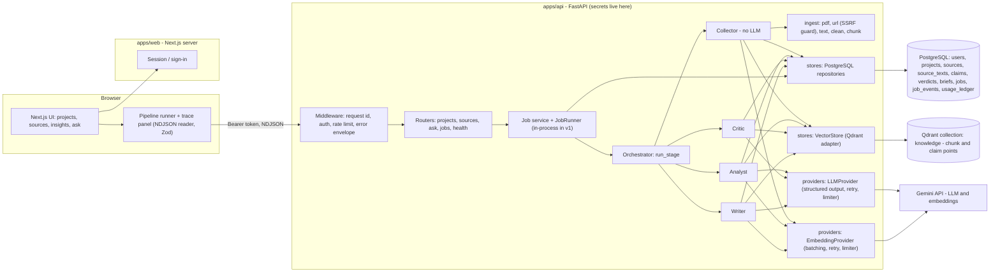

# Design Document: Research Desk

Version 0.4 | Target architecture: Next.js frontend, FastAPI (Python) backend, PostgreSQL system of record, Qdrant evidence memory, Gemini provider. Read together with `03-DATABASE-SCHEMA.md`, `04-AGENT-SPECS.md` and `05-API-SPEC.md`. Nothing in this document is implemented yet; numbers marked "default" are starting values to tune, not measurements.

## 1. Overview

Research Desk is two independently deployable applications in one repository:

- **`apps/web`:** Next.js (App Router), React, TypeScript, Tailwind. UI, session handling and frontend-only logic (NDJSON reader, trace store, Zod validation of API responses).
- **`apps/api`:** Python and FastAPI. All API requests, authentication checks, validation, document processing, job orchestration, the four agents, provider adapters and streaming.

The browser never talks to Gemini, PostgreSQL or Qdrant. The API runs four agents (one without an LLM, three LLM-backed). They share one evidence memory: PostgreSQL holds the authoritative records, and one Qdrant collection holds the searchable chunk and claim vectors. All secrets stay on the API server. Gemini provides both the LLM and the text embeddings.

Design principles:
1. **One memory, many agents.** Agents never call each other. They communicate by writing and reading persisted records (PostgreSQL and Qdrant), and the orchestrator is the only caller of agents.
2. **One stage per job.** Each pipeline stage (`collect`, `analyze`, `critique`, `ask`) is its own job. Jobs run detached from the HTTP request, so a closed tab does not kill work. The browser chains the three source stages.
3. **Adapters at the edges.** Gemini sits behind `LLMProvider` and `EmbeddingProvider`; Qdrant behind `VectorStore`; PostgreSQL behind repositories. Swapping a provider touches one module.
4. **PostgreSQL is the system of record; Qdrant is a rebuildable index.** If Qdrant is lost, it can be rebuilt from PostgreSQL at the cost of embedding calls only.
5. **Idempotent by construction.** Deterministic, project-scoped keys, upserts, single-flight jobs and idempotency keys mean retries overwrite instead of duplicating.
6. **Few, batched external calls.** LLM: about 3 calls per source plus 1 per question. Embeddings: batched, only for chunks and claims. Qdrant: one batched query for the Critic.
7. **Modular monolith first, with seams.** One backend process runs all agents. Interfaces for the job runner, rate limiter, event sink and providers let workers, a persistent queue and other model providers be added later without rewrites. No microservice, broker or cache is added before measurements justify it (section 14).
8. **Free-first, cost-bounded.** Free tiers and local Docker are the default for development and demo; budgets and caps apply everywhere.
9. **Secure by default.** Authenticated, owner-scoped, validated and time-boxed at every boundary (section 13).

## 2. System architecture



Service boundaries:

| Component | Owns | Does not do |
|---|---|---|
| Next.js (`apps/web`) | Pages, components, session, API client, NDJSON reader, trace store, Zod validation, UI state | Call Gemini, PostgreSQL or Qdrant; hold provider keys; run agents; process documents |
| FastAPI (`apps/api`) | HTTP API, authn/authz, input validation, rate limits, job orchestration, agents, document processing, provider adapters, streaming | Render UI |
| PostgreSQL | Users, projects, sources, extracted text, claims, verdicts, briefs, jobs, job events, usage ledger, app metadata | Vector search |
| Qdrant | Chunk and claim vectors with filterable payload; similarity search | Authoritative state; ownership; job state |
| Gemini | LLM inference and embeddings, only through the provider adapters | Anything else |

## 3. Data flows

### 3.1 Adding a source (three stages)

```mermaid
sequenceDiagram
  participant U as User
  participant B as Browser runner
  participant A as FastAPI
  participant J as Job runner
  participant C as Collector
  participant N as Analyst
  participant R as Critic
  participant P as PostgreSQL
  participant D as Qdrant
  participant G as Gemini

  U->>B: Upload PDF, paste text, or enter URL
  B->>A: POST /api/projects/:id/sources (Bearer token)
  A->>P: check owner, caps, idempotency; create job
  A->>J: start job (detached from request)
  A-->>B: NDJSON stream tails job_events
  J->>C: collect
  C->>P: upsert source + source_text (stage flags false)
  C->>G: embed chunks (batched)
  C->>D: upsert chunk points, prune stale
  C->>P: chunk_count, stage_collected = true
  B->>A: POST .../sources/:sid/analyze
  J->>N: analyze
  N->>P: read source_text
  N->>G: summary + claims (one structured call)
  N->>G: embed claims (one batch)
  N->>P: replace claims (cascade stale verdicts), flags false
  N->>D: upsert claim points, prune stale
  N->>P: stage_analyzed = true
  B->>A: POST .../sources/:sid/critique
  J->>R: critique
  R->>D: claim vectors, then batched query: similar claims from OTHER sources
  R->>P: skip already-judged pairs
  R->>G: batched verdicts (one structured call)
  R->>P: upsert verdicts, stage_critiqued = true
```

### 3.2 Asking a question

```mermaid
sequenceDiagram
  participant U as User
  participant B as Browser
  participant A as FastAPI
  participant W as Writer
  participant P as PostgreSQL
  participant D as Qdrant
  participant G as Gemini

  U->>B: Type research question
  B->>A: POST /api/projects/:id/ask
  A->>P: check owner, budget; create job
  A-->>B: NDJSON stream
  A->>W: run (detached job)
  W->>G: embed question (query task type)
  W->>D: search chunks + claims in project
  W->>P: load sources (tags, titles, stage flags); drop hits from unknown or incomplete sources
  W->>P: query conflicts (contradicts, nuances)
  W->>G: question + tagged context (one structured call)
  W->>W: validate citation tags
  W->>P: upsert brief
```

## 4. Components

Paths are relative to `apps/api/src/research_desk/` unless stated.

| Component | Responsibility | Key rules |
|---|---|---|
| `apps/web/src/app/` pages | Sign-in, Home, project page with tabs Sources, Insights, Ask; trace drawer | No secrets, no provider calls; calls only the FastAPI API |
| `apps/web/src/lib/api/` | Typed fetch client, Zod schemas, NDJSON reader | Validates every response and event with Zod; unknown event types ignored |
| `main.py`, `api/` | App factory, routers, dependencies, error handlers, middleware | Validate with Pydantic; every project route uses the single `get_owned_project` dependency; never return stack traces |
| `core/config.py` | Typed settings (pydantic-settings) and constants | Fail fast with a readable message listing missing variables; refuse unsafe combinations (for example `AUTH_MODE=dev` outside `APP_ENV=local`) |
| `core/ids.py` | Keys, short hashes, UUIDv5 point IDs | See schema doc; unit-tested for determinism |
| `core/schemas.py` | Pydantic models for API, events and agent outputs; `CamelModel` base | Wire format is camelCase via aliases; Python attributes are snake_case |
| `core/logging.py`, `core/errors.py` | Structured JSON logging, redaction, error types and the single user-message map | Never log secrets, source text, prompts or model output |
| `orchestrator/pipeline.py` | `run_stage(stage, ctx, emit)` dispatches to agents and standardizes events | Stages: `collect`, `analyze`, `critique`, `ask`; only caller of agents |
| `orchestrator/jobs.py` | Job service: create, single-flight, idempotency, lease, heartbeat, recovery sweep | Jobs persisted in PostgreSQL; see `05-API-SPEC.md` section 6 |
| `orchestrator/runner.py` | `JobRunner` protocol and `InProcessRunner` | The only place that knows jobs run in-process (seam for workers) |
| `orchestrator/events.py` | `EventSink` protocol; PostgreSQL sink with local fan-out | Events are persisted; streams tail them |
| `agents/*.py` | `collector.py`, `analyst.py`, `critic.py`, `writer.py`, `prompts.py` | One module per agent; explicit input and output models; use injected Protocols only |
| `ingest/*.py` | `pdf.py`, `url.py`, `ssrf.py`, `text.py`, `clean.py`, `chunk.py` | Pure functions where possible; CPU-bound work runs off the event loop with a timeout; unit-tested |
| `providers/embeddings.py`, `providers/llm.py` | Provider protocols | Agents import only these |
| `providers/gemini.py` | The only module that imports the Gemini SDK | Structured output, retries, timeouts, usage accounting |
| `providers/limits.py` | `RateLimiter` protocol, in-process implementation, global Gemini concurrency semaphore | Shared implementation is a later seam (section 14) |
| `stores/vector.py` | `VectorStore` protocol and Qdrant adapter; the only module that imports the Qdrant client | Filters built only from validated IDs and enums; every similarity search filters on `type` and `projectId` |
| `stores/repos/*.py`, `stores/db.py` | PostgreSQL repositories and transaction helper (SQLAlchemy 2, async) | Only these modules run SQL; parameterized queries only |
| `alembic/` | PostgreSQL migrations | Reviewed expand/contract changes (section 13.9) |
| `scripts/*.py` | `migrate_qdrant.py`, `spike_*.py`, `reconcile.py` (Stage 7) | Idempotent; no secrets printed |

## 5. Adapter contracts

All adapters are `typing.Protocol` classes defined next to their consumers' layer and injected through FastAPI dependencies and the orchestrator context, so tests substitute fakes. Signatures below are sketches; exact signatures are fixed in Stage 1 after the spikes. Library method names for Qdrant and the Gemini SDK are NOT specified here; open the official docs and follow them.

```python
# providers/embeddings.py
EmbedKind = Literal["document", "query"]

class EmbeddingProvider(Protocol):
    async def embed_texts(
        self, texts: Sequence[str], kind: EmbedKind, *, ctx: CallContext
    ) -> list[list[float]]: ...
# Guarantees: output length equals input length; every vector has length EMBEDDING_DIM.
```

```python
# providers/llm.py
T = TypeVar("T", bound=BaseModel)
Tier = Literal["fast", "strong"]

@dataclass(frozen=True)
class CallContext:
    user_id: UUID
    project_id: str | None
    job_id: UUID | None      # used for the usage ledger, fairness and logs

class LLMProvider(Protocol):
    async def call(
        self, *, tier: Tier, system: str, user: str, schema: type[T],
        temperature: float = 0.2, ctx: CallContext,
    ) -> LLMResult[T]: ...
# LLMResult has .data: T and .usage (tokens in/out if the provider reports them).
```

Behavior of `LLMProvider.call` (Gemini implementation): request JSON output using the SDK's structured-output option (spike S7 decides how the Pydantic schema is passed); parse; validate with Pydantic; on parse or validation failure retry up to `LLM_MAX_RETRIES` with the validation error appended; on HTTP 429 or transient 5xx wait with bounded jittered backoff, honouring any retry-after hint; enforce a per-call timeout (`LLM_TIMEOUT_S`); acquire the global concurrency semaphore (`GEMINI_MAX_CONCURRENCY`) and the minimum-interval gate (`LLM_MIN_INTERVAL_MS`); write a `usage_ledger` row; raise a typed `ProviderError` subclass carrying a user-safe message and a `retryable` flag. A circuit breaker that fails fast after repeated provider errors is a later addition (section 14).

```python
# stores/vector.py
class VectorStore(Protocol):
    async def upsert_chunks(self, rows: Sequence[ChunkPoint]) -> None: ...      # includes embeddings
    async def upsert_claims(self, rows: Sequence[ClaimPoint]) -> None: ...      # includes embeddings
    async def prune(self, project_id: str, source_id: str,
                    type_: Literal["chunk", "claim"], keep_count: int) -> None: ...  # delete stale indexes >= keep_count
    async def get_claim_vectors(self, project_id: str, source_id: str) -> list[ClaimVector]: ...
    async def find_similar_claims_from_other_sources(
        self, project_id: str, source_id: str, claims: Sequence[ClaimVector],
        top_k: int, min_similarity: float) -> list[ClaimNeighbors]: ...          # ONE batched request
    async def search_chunks(self, project_id: str, embedding: Sequence[float], top_k: int) -> list[Hit]: ...
    async def search_claims(self, project_id: str, embedding: Sequence[float], top_k: int) -> list[Hit]: ...
    async def delete_source(self, project_id: str, source_id: str) -> None: ...
    async def delete_project(self, project_id: str) -> None: ...
    async def count(self, project_id: str, type_: Literal["chunk", "claim"],
                    source_id: str | None = None) -> int: ...                    # for reconcile
    async def ping(self) -> None: ...
```

```python
# stores/repos (PostgreSQL) - sketch of the methods agents and routers need
class ProjectRepo(Protocol):
    async def create(self, owner_id: UUID, name: str, description: str | None) -> Project: ...
    async def get_owned(self, owner_id: UUID, project_id: str) -> Project | None: ...  # None also when not owner
    async def list_for_owner(self, owner_id: UUID) -> list[ProjectSummary]: ...
    async def mark_deleting(self, project_id: str) -> None: ...
    async def delete(self, project_id: str) -> None: ...

class SourceRepo(Protocol):
    async def upsert_collecting(self, s: SourceDraft, text: SourceText) -> SourceRecord: ...  # allocates tag under project lock
    async def get_text(self, project_id: str, source_id: str) -> SourceText: ...
    async def mark_collected(self, project_id: str, source_id: str, chunk_count: int) -> None: ...
    async def update_analysis(self, ...) -> None: ...
    async def list(self, project_id: str) -> list[SourceRecord]: ...
    async def delete(self, project_id: str, source_id: str) -> None: ...                       # cascades claims and verdicts

class ClaimRepo(Protocol):
    async def replace_for_source(self, project_id: str, source_id: str,
                                 rows: Sequence[ClaimRecord]) -> None: ...     # cascades verdicts, clears stage_critiqued
    async def list_for_source(self, project_id: str, source_id: str) -> list[ClaimRecord]: ...

class VerdictRepo(Protocol):
    async def existing_keys(self, project_id: str, keys: Sequence[str]) -> set[str]: ...
    async def upsert_many(self, project_id: str, rows: Sequence[VerdictRecord]) -> None: ...
    async def list_conflicts(self, project_id: str, labels: Sequence[str], limit: int,
                             prefer_claim_keys: Sequence[str] = ()) -> list[ConflictView]: ...

class BriefRepo(Protocol):
    async def upsert(self, project_id: str, b: BriefRecord) -> None: ...
    async def get(self, project_id: str, key: str) -> BriefRecord | None: ...

class JobRepo(Protocol): ...    # create/single-flight/claim/heartbeat/finish/append_event/list_events; see 05-API-SPEC.md section 6
class UsageRepo(Protocol): ...  # record(...) and totals_for_user_since(...) for budgets
```

```python
# orchestrator/runner.py and events.py - the scale-out seams
class JobRunner(Protocol):
    async def submit(self, job: Job, work: Callable[[EventSink], Awaitable[None]]) -> None: ...

class EventSink(Protocol):
    async def emit(self, event: StageEvent) -> None: ...   # persists to job_events, notifies local tailers
```

`InProcessRunner` starts the work as a detached `asyncio` task (reference kept in a set), enforces `MAX_ACTIVE_JOBS` and `MAX_ACTIVE_JOBS_PER_USER`, renews the job lease every `JOB_HEARTBEAT_S`, and applies the stage timeout. A future `WorkerRunner` would only enqueue; a separate worker process would claim jobs from PostgreSQL. The agent code does not change.

## 6. Streaming and trace events

Each stage endpoint responds with `application/x-ndjson`: one JSON object per line. The response tails the persisted `job_events` of the job (including replay from sequence 0 for a new request, or from `after` on reconnect). Because the job is detached from the request, a client disconnect does not stop the work. Event shape and endpoints are in `05-API-SPEC.md`. Event names: `stage_start`, `step`, `llm_call`, `doc_write`, `doc_read`, `warning`, `error`, `result`, `stage_end`, plus `heartbeat` (keep-alive, hidden in the trace panel).

Streaming responses set `Cache-Control: no-store` and `X-Accel-Buffering: no`, and send a `heartbeat` event every `STREAM_HEARTBEAT_S` so proxies with idle timeouts do not cut the connection. Whether the chosen hosts buffer or cut streams is verified in spike S9, not assumed.

The browser-side runner for adding a source: `collect -> analyze -> critique`. If a stage fails, the runner stops, shows the error, and offers "Retry stage". Retrying is safe because writes are idempotent and a duplicate submit attaches to the running job instead of starting another (single-flight). If the page is reloaded mid-stage, the runner finds the active job from the project response and re-attaches to its event stream.

## 7. Configuration (starting defaults; tune on day 1)

Constants live in `core/config.py`. Any constant can be overridden by an environment variable of the same name. All values are defaults, not measurements.

| Constant | Default | Meaning |
|---|---|---|
| `MAX_SOURCES_PER_PROJECT` | 8 | Hard cap |
| `MAX_UPLOAD_MB` | 8 | PDF size cap; enforced while streaming the body, not after buffering (also check host body-size limit) |
| `MAX_PDF_PAGES` | 100 | Reject longer PDFs before extraction (value is an assumption; tune in S8) |
| `PDF_PARSE_TIMEOUT_S` | 30 | Hard time limit for extraction |
| `MAX_EXTRACTED_CHARS` | 400000 | Cap on text kept per source after extraction |
| `MAX_PASTE_CHARS` | 400000 | Cap on pasted text |
| `MIN_SOURCE_CHARS` | 500 | Below this, reject as empty or scanned |
| `CHUNK_TARGET_CHARS` | 1200 | Chunk size (embedding input is limited to about 2,048 tokens) |
| `CHUNK_OVERLAP_CHARS` | 150 | Overlap between chunks |
| `EMBEDDING_DIM` | 768 | Must equal the Qdrant vector size |
| `EMBED_BATCH_SIZE` | 50 | Texts per embedding request (confirm maximum in spike S2) |
| `EMBED_MIN_INTERVAL_MS` | 700 | Gap between embedding requests (per process; see section 14) |
| `MAX_ANALYST_CHARS` | 80000 | Max text sent to the Analyst (first 50k + last 30k if longer) |
| `MAX_CLAIMS_PER_SOURCE` | 8 | Analyst cap |
| `CRITIC_TOP_K` | 3 | Neighbors per claim |
| `CRITIC_MIN_SIMILARITY` | 0.60 | Qdrant score threshold (cosine similarity); a guess, tune in spike S4 |
| `CRITIC_MAX_PAIRS_PER_CALL` | 24 | Pairs per LLM call; with the defaults above the maximum pair count is 8 x 3 = 24, so one call suffices; if caps are raised, pairs are split into sequential calls |
| `WRITER_TOP_CHUNKS` | 6 | Retrieval for briefing |
| `WRITER_TOP_CLAIMS` | 10 | Retrieval for briefing |
| `WRITER_MAX_CONFLICTS` | 5 | Conflicts included in context |
| `LLM_MAX_RETRIES` | 2 | Parse/validation retries |
| `LLM_MIN_INTERVAL_MS` | 2000 | Gap between LLM calls (per process) |
| `GEMINI_MAX_CONCURRENCY` | 2 | Global in-flight Gemini requests per process |
| `LLM_TIMEOUT_S` / `EMBED_TIMEOUT_S` / `QDRANT_TIMEOUT_S` | 60 / 30 / 10 | Per-call timeouts |
| `STAGE_TIMEOUT_S` | 180 | Whole-stage limit; job fails with `TIMEOUT` |
| `JOB_LEASE_S` / `JOB_HEARTBEAT_S` | 60 / 15 | Lease and renewal for running jobs |
| `STREAM_HEARTBEAT_S` | 15 | Heartbeat events on open streams |
| `MAX_ACTIVE_JOBS` / `MAX_ACTIVE_JOBS_PER_USER` | 4 / 2 | Overload and fairness caps; beyond them the API returns `503`/`429` with retry hint |
| `RATE_LIMIT_POST_PER_USER` | 30 per 10 min | Example value from the original design; tune |
| `RATE_LIMIT_IP_PER_MIN` | 60 | Unauthenticated and pre-auth traffic |
| `USER_DAILY_LLM_CALLS` / `USER_DAILY_EMBED_TEXTS` | unset until Stage 1 spike S6 | Per-user budgets (section 13.12) |
| `LLM_ENABLED` | true | Global kill switch; false returns `QUOTA_EXCEEDED` for agent stages |
| `DB_POOL_SIZE` / `DB_MAX_OVERFLOW` | 10 / 5 | PostgreSQL pool; keep total connections within the database limit |
| `SHUTDOWN_GRACE_S` | 30 | Wait for running jobs on SIGTERM before marking them interrupted |
| `URL_MAX_REDIRECTS` / `URL_MAX_BYTES` / `URL_TIMEOUT_S` | 3 / 5 MB / 10 | URL fetch limits |

Environment variables by service are listed in `README.md`.

## 8. Error handling

All non-stream errors use one envelope (`05-API-SPEC.md` section 1). User messages come from one message map in `core/errors.py`; the frontend maps `code` to its own copy of the same text.

| Failure | Behavior |
|---|---|
| Missing or invalid credentials | 401 `UNAUTHENTICATED`; the UI sends the user to sign in |
| Project missing or owned by someone else | 404 `NOT_FOUND` in both cases (no existence leak) |
| Invalid upload (type, size, pages, encrypted) | 400/413/415 with message; nothing written |
| No extractable text | 422 `NO_TEXT` "No readable text found. If this is a scanned PDF, paste the text instead." |
| URL blocked or fetch fails | 422 `FETCH_BLOCKED` / `FETCH_FAILED` with paste fallback message |
| Duplicate submit | Attach to the running job (single-flight); same Idempotency-Key with different input returns 409 `IDEMPOTENCY_CONFLICT` |
| LLM invalid JSON after retries | Stage ends with `error` event (`LLM_INVALID`); partial writes are safe to repeat |
| Provider rate limit or quota | Bounded backoff, then `error` `LLM_QUOTA` "Quota reached, try again later", `retryable: true` |
| User budget or kill switch | `QUOTA_EXCEEDED` with the limit named |
| Request rate exceeded | 429 `RATE_LIMITED` with `Retry-After` |
| Server overloaded (active job cap) | 503 `OVERLOADED` with `Retry-After` |
| Stage exceeds time limit | `error` `TIMEOUT`, job `failed`, retryable |
| API restarted during a job | Recovery sweep marks the job `failed` with `INTERRUPTED`, retryable |
| PostgreSQL unreachable | `DB_ERROR` "Database is unavailable"; details logged server-side only |
| Qdrant unreachable or cluster paused | `VECTOR_DB_ERROR` "Search index is unavailable" with a hint to check the cluster; details logged server-side only |
| Unexpected exception | `INTERNAL` with a request ID the user can quote; stack trace logged only |

## 9. Security design

Summary here; the full production requirements are in section 13.

- Authentication on every route except `GET /api/health`. Project ownership is enforced in one dependency used by every project-scoped route.
- Keys, the database URL and the Qdrant URL and key only in API server env vars. `.env*` in `.gitignore`; only `.env.example` files committed.
- **Qdrant and SQL:** build filters and queries only from validated IDs and fixed enums, never from raw user text; SQL is parameterized.
- **SSRF protection** for URL fetching: allow only `http`/`https`; resolve the hostname once, reject loopback, private, link-local, multicast, reserved and metadata addresses (IPv4 and IPv6, including IPv4-mapped forms), then connect to the validated IP (pinned) so DNS rebinding cannot change the target; re-validate every redirect hop; response size and time limits.
- Upload validation: MIME type and `%PDF` magic bytes; size enforced while streaming; page count and parse time limits; encrypted PDFs rejected.
- Treat all source text as untrusted. Prompts say source text is data, not instructions; Writer output is validated (citation tags) before display; Markdown is rendered safely (no raw HTML).
- Per-user and per-IP rate limits, active-job caps and per-user daily budgets protect quotas and cost.
- Privacy note in the UI: text is sent to Google's Gemini API; free-tier content may be used by Google to improve products (confirm current terms).

## 10. UI specification

### Screens
1. **Sign-in:** provider-defined (U1); shows session-expired state.
2. **Home:** project list, "New project" form.
3. **Project page** with three tabs and a trace drawer:
   - **Sources:** drop zone (PDF), "Add URL", "Paste text"; source cards showing title, kind, stage chips (Collected / Analyzed / Critiqued), claim count, delete action.
   - **Insights:** per-source summary and claims; **Conflicts** list with side-by-side claim cards, stance badge, confidence, rationale; filter (contradicts, nuances, supports).
   - **Ask:** question box, example questions, briefing view with clickable `[S#]` tags, disagreement cards, "gaps" note.
   - **Trace drawer:** live event feed, color-coded per agent; shows "reconnecting" when the stream drops and resumes.

### Visual language
- Clean, spacious, readable; light and dark themes.
- Agent colors (consistent everywhere): Collector = gray, Analyst = blue, Critic = amber, Writer = green.
- Stance badges use color **and** icon/text: Contradicts (red, "!"), Nuances (amber, "~"), Supports (green, check), Unrelated (gray).

### States to design for
Signed out, session expired, empty project, uploading, stage running, stage reconnecting, stage failed (with Retry), stage interrupted (with Retry), no conflicts found ("sources broadly agree"), quota or rate-limit error (with retry time when known), search index unavailable, database unavailable, long text truncation.

## 11. Deployment

Frontend and backend deploy independently. The API is a container image; the frontend is a standard Next.js deployment. Hosts for each are an open decision (U2); nothing below assumes a specific provider or free-tier limit.

### Local development (Docker Compose)
`docker-compose.yml` (created in Stage 0) defines:

| Service | Image or build | Port (bound to 127.0.0.1) | Notes |
|---|---|---|---|
| `postgres` | official PostgreSQL image | 5432 | named volume; healthcheck; credentials from `.env` |
| `qdrant` | official Qdrant image | 6333 (HTTP), 6334 (gRPC if used) | named volume; healthcheck |
| `api` (profile `full`) | `apps/api/Dockerfile` | 8000 | runs migrations first via a one-shot command; optional, since day-to-day development runs the API with `uv run uvicorn` |
| `web` (profile `full`) | `apps/web/Dockerfile` | 3000 | optional, same reason |

Day-to-day: `docker compose up -d postgres qdrant`, run the API and web with their own dev servers.

### Production shape
- **API:** one container, one uvicorn worker, one replica in v1 (in-process job runner and in-process limiters make more than one instance unsafe; see section 14 for the scale-out gate). Needs a host that supports long-lived HTTP connections and streaming responses; idle timeout and buffering are verified in S9. Run `alembic upgrade head` as a separate release step before starting a new version, never inside app startup.
- **Web:** Next.js deployment; configured with the public API base URL. Browser calls to the API are cross-origin: set `CORS_ALLOWED_ORIGINS` to the exact web origin(s), allow only needed methods and the `Authorization` and `Idempotency-Key` headers, no wildcard with credentials.
- **PostgreSQL:** managed instance preferred (automated backups, point-in-time recovery if offered; U9). TLS required.
- **Qdrant:** Qdrant Cloud cluster or a self-hosted container with a persistent volume. Run `scripts/migrate_qdrant.py` once per environment.
- **Secrets:** host secret store or environment injection; never baked into images; rotated on suspicion of leak (section 13.2).
- **Free-tier pause (Qdrant Cloud):** a free cluster may pause after inactivity. Options: (a) a scheduled job calling `GET /api/health?db=1` (confirm this counts as activity); (b) accept the pause and show the "search index unavailable" message; (c) self-host the open-source image or move to a paid tier. Because the index is rebuildable from PostgreSQL, a lost free cluster is recoverable.
- **Embedding fallback (fully free, no quota):** a small open-source embedding model run locally or on the server. Its output dimension differs (often 384), so the collection vector size must match the model chosen on day 1. Do not mix models in one collection; changing models means re-embedding into a new collection and swapping an alias (`03-DATABASE-SCHEMA.md` section 3).
- **Health and readiness:** `GET /api/health` is liveness (booleans only). `GET /api/health?db=1` checks PostgreSQL and Qdrant and is the readiness and keep-alive target.

## 12. Testing approach (summary)

- **Backend (Pytest):** unit tests for chunking, cleaning, key and UUID generation, Pydantic schemas, citation-tag validator, SSRF guard, embedding batching, rate limiter, job state machine. Agent tests use fake `LLMProvider`, `EmbeddingProvider` and in-memory or test-database stores. Integration tests run against Docker Compose PostgreSQL and Qdrant with a throwaway database and collection: idempotent upserts, filtered search, delete by project, tag allocation under concurrency, single-flight job creation, cross-user isolation.
- **Frontend (Vitest):** unit tests for the NDJSON reader (split chunks, partial lines, unknown events, reconnect), trace store, runner state machine, Zod schemas, error-message mapping.
- **Contract tests:** JSON fixtures in `contracts/` are validated by Pydantic models in Pytest and by Zod schemas in Vitest, so the two sides cannot drift silently.
- **Manual:** end-to-end script before every deploy. Details in `07-BUILD-PLAN-AND-CHECKLIST.md`.

## 13. Production requirements

Each item states the requirement and how it is met; "Stage" names where it is built.

### 13.1 Authentication and project ownership (Stage 1 backend skeleton, Stage 3 UI, Stage 7 hardening)
- Every route except `GET /api/health` requires `Authorization: Bearer <token>`. FastAPI verifies the token (signature via the issuer's published keys, issuer, audience, expiry) and maps the subject to a row in `users`. The identity provider is undecided (U1).
- `AUTH_MODE=dev` (a fixed local user, header-selectable) exists only for local development and tests; the app refuses to start with it unless `APP_ENV=local`.
- `get_owned_project(project_id, user)` loads the project only if `owner_id` matches; otherwise 404. Every project-scoped route, job and event stream uses it. Jobs also carry `user_id`, and the events endpoint checks job ownership.
- Cross-user isolation has dedicated tests (metric M7).

### 13.2 Secrets management (Stage 0, Stage 8)
- Secrets (`GEMINI_API_KEY`, `DATABASE_URL`, `QDRANT_API_KEY`, auth secrets) only in server environment variables or the host secret store. Never in code, images, logs, the frontend bundle or prompts. `NEXT_PUBLIC_*` variables hold no secrets.
- Settings objects redact secret fields in `repr` and logs. Secret scan of the repository and git history before release.
- Use least-privilege credentials (a PostgreSQL role without superuser rights; a Qdrant key limited to what the app needs where the product allows). Rotation procedure documented in the deployment notes (Stage 8).

### 13.3 Input validation (every stage)
- Pydantic models validate every request body, query and path parameter, with length and enum constraints (question 5-500 characters, project name 1-80, and so on). Zod validates every response and stream event in the browser.
- IDs from the URL are matched against the key patterns before use; invalid IDs return 400/404 without touching a store.
- LLM output is validated with Pydantic before any use; invalid output is retried, then fails the stage.

### 13.4 SSRF protection (Stage 2)
As in section 9, implemented in `ingest/ssrf.py` and used by `ingest/url.py` through a custom HTTP transport that connects to the validated address. Tested with: localhost, 127.x, `::1`, 10.x, 172.16-31.x, 192.168.x, 169.254.x (including the cloud metadata address), IPv4-mapped IPv6, decimal and hexadecimal IP forms, userinfo tricks, a hostname resolving to a private address, a redirect to a private address, a DNS answer that changes between lookups, non-http schemes. The API process should additionally run without network access to internal services it does not need (deployment hardening, Stage 8).

### 13.5 File-size and processing limits (Stage 2)
- Upload size is enforced while reading the body (and by `Content-Length` pre-check); the body is spooled to a temporary file, never fully held in memory beyond the limit.
- Page count, extracted-character and parse-time limits (`MAX_PDF_PAGES`, `MAX_EXTRACTED_CHARS`, `PDF_PARSE_TIMEOUT_S`). Extraction runs off the event loop; whether a thread is enough or a subprocess is needed for isolation is decided in S8.
- Temporary files are deleted when the job ends, success or failure. PDFs are never stored.

### 13.6 Rate limiting and concurrency (Stage 7; skeleton earlier)
- `RateLimiter` protocol; token-bucket in-process implementation keyed by user (authenticated routes) and by IP (health and pre-auth). Limits in section 7.
- `MAX_ACTIVE_JOBS_PER_USER` and `MAX_ACTIVE_JOBS` bound concurrency; excess returns 429/503 with `Retry-After`.
- In-process limiters are per instance. This is why v1 is a single instance; moving to several requires a shared limiter first (section 14).

### 13.7 Retries and timeouts (Stage 1, Stage 7)
- Every outbound call has a timeout (`LLM_TIMEOUT_S`, `EMBED_TIMEOUT_S`, `QDRANT_TIMEOUT_S`, `URL_TIMEOUT_S`) and every stage a total limit (`STAGE_TIMEOUT_S`).
- Retries are bounded, use exponential backoff with jitter, and apply only to errors known to be transient (429, 5xx, connection reset). Validation failures retry with the error appended (LLM only). Non-idempotent side effects are never retried blindly: all stage writes are upserts, so repeating them is safe.
- A retry never exceeds the remaining stage time.

### 13.8 Idempotency (Stage 1, Stage 2)
- Data level: deterministic project-scoped keys and upserts (`03-DATABASE-SCHEMA.md` section 4).
- Job level: single-flight per (project, stage, source, input hash) enforced by a partial unique index on active jobs; a duplicate request attaches to the running job.
- Client level: optional `Idempotency-Key` header on POST stage routes, unique per user; replay returns the original job; reuse with different input returns 409.

### 13.9 Database migrations (Stage 1, ongoing)
- PostgreSQL: Alembic migrations, reviewed, committed with the code. Expand/contract rule: add columns or tables first (backward compatible), deploy code, then remove old structures in a later release. Run as a release step with a single runner. Never edit an applied migration.
- Qdrant: `scripts/migrate_qdrant.py` creates the collection and payload indexes idempotently. The collection is addressed through an alias so a re-embedding migration can build a new collection and switch the alias. `schemaVersion` in payloads supports payload evolution. `app_meta` pins the embedding model and dimension; startup fails on mismatch.
- CI applies all migrations to an empty database and checks that the ORM models match (autogenerate diff is empty).

### 13.10 Structured logging and monitoring (Stage 0 logging, Stage 7 metrics)
- JSON logs (one object per line) with `ts`, `level`, `request_id`, `job_id`, `user_id` (opaque ID, not email), `project_id`, `stage`, `event`, `duration_ms`, and error `code`. Request IDs are accepted from a trusted proxy header or generated, returned in `X-Request-Id`, and echoed in error bodies.
- Never log source text, prompts, model output, tokens, keys, or full URLs with credentials. A redaction filter and a test enforce this.
- Metrics (names are suggestions): stage duration histogram by stage and outcome; provider call count, latency and error rate by provider and tier; tokens used; active jobs; job failures by code; PostgreSQL pool wait time; Qdrant query latency; event-loop lag; rate-limit rejections.
- Alerts (set after baseline measurement in Stage 7): sustained provider errors, job failure rate, interrupted jobs after restart, pool exhaustion, Qdrant or PostgreSQL unreachable, budget burn rate. Choice of metrics and tracing backend is open (U8); OpenTelemetry-compatible instrumentation is the intended default.

### 13.11 Backups and recovery (Stage 8; drill before release)
- PostgreSQL: automated backups with the host's capabilities (point-in-time recovery if available; U9). Restore is tested once into a scratch database and the application is started against it.
- Qdrant: either scheduled snapshots, or no snapshots and rely on rebuild from PostgreSQL. Decide after measuring rebuild time and embedding cost (U9). `scripts/reconcile.py` verifies counts per source between stores and reports drift; a documented `rebuild_index` procedure re-chunks from `source_texts`, re-embeds chunks and claims, and upserts them. Rebuild consumes embedding quota.
- After a PostgreSQL restore to an earlier point, run reconcile: Qdrant points whose records no longer exist are invisible (retrieval post-filters against PostgreSQL) and are removed by reconcile.
- Deleted projects remain in backups until backups expire; the retention period is stated in the privacy notice (U15).

### 13.12 Cost controls (Stage 1 ledger, Stage 7 enforcement)
- Caps: sources per project, claims per source, neighbors per claim, text sent to the Analyst, retrieval sizes, question length.
- Batching: embeddings in batches; one Analyst call per source; one batched Critic call; one Writer call.
- Per-user daily budgets from the `usage_ledger` (calls and tokens or embedded texts; values set after S6). When exceeded, agent stages return `QUOTA_EXCEEDED` before any provider call.
- Global kill switch `LLM_ENABLED`; global concurrency semaphore; active-job caps.
- Ledger stores provider-reported token counts; money cost is computed from an optional price table in config and is not assumed (prices not hard-coded).
- Content-hash idempotency means the same source in the same project is never re-embedded or re-analyzed unless the user re-runs a stage. A development-only LLM response cache (gitignored folder, keyed by prompt hash) saves quota while tuning prompts; it is disabled outside `APP_ENV=local`.

## 14. Scalability and bottleneck register

Strategy: build the simplest thing that is correct and bounded; keep the seams in section 5; scale only on measured signals. Targets are not claimed; thresholds are set after Stage 7 measurements.

### 14.1 Scale-out ladder

| Level | Shape | Move up when | What it requires |
|---|---|---|---|
| 0 (v1) | One API instance, one uvicorn worker, in-process `JobRunner`, in-process limiters | start here | Everything in this document |
| 1 | Separate worker process (same codebase, `python -m research_desk.worker`) that claims jobs from PostgreSQL (`FOR UPDATE SKIP LOCKED`); API only enqueues and tails events | Event-loop lag or API latency from job CPU/IO, or deploys that interrupt long jobs | Shared rate limiter (U17); transient blob store for uploaded PDFs handed to workers (U10); worker lease and re-queue logic; PostgreSQL event tailing |
| 2 | Several workers and several API replicas; connection pooler in front of PostgreSQL | Queue wait time grows, or one worker is saturated | Shared limiter proven; pool sizing reviewed; per-user fairness in claiming |
| 3 | Larger or sharded Qdrant, quantization, alternate model provider or tiered models, optional Redis only if PostgreSQL contends for limiter or queue work | Measured memory, latency, quota or cost pressure | Evidence from metrics; a new decision recorded in section 15 |

Not planned: microservices per agent, a separate broker, or a cache layer before evidence.

### 14.2 Bottleneck register

| # | Area | Bottleneck | Early signal | Mitigation in v1 | Escalation (when justified) |
|---|---|---|---|---|---|
| B1 | Gemini quota and rate | Free-tier or paid limits shared by all users; per-process spacing breaks with several instances | 429s, rising stage latency | Batching, global concurrency semaphore, minimum intervals, per-user budgets, kill switch, usage ledger | Shared limiter (PostgreSQL or Redis), tiered models, alternate provider behind the adapters, paid quota |
| B2 | Long LLM calls hold resources | Slow calls pile up active jobs | Active jobs at cap, `OVERLOADED` responses | Detached jobs, timeouts, active-job caps, fairness per user | Worker process (Level 1), more workers |
| B3 | Event loop blocked | PDF parsing, text cleaning, article extraction are CPU-bound | Event-loop lag metric rises during uploads | Run CPU work in a thread (or subprocess if S8 requires), size and page limits, timeouts | Move processing to workers; process pool |
| B4 | Upload memory and temp disk | Concurrent large uploads | Memory growth, disk full | Streamed size limit, spooled temp files deleted at job end, `MAX_UPLOAD_MB` | Direct-to-object-storage upload (U10) when workers split |
| B5 | Detached job lost on restart or deploy | Running jobs die with the process | `INTERRUPTED` failures after deploys | Lease and heartbeat, recovery sweep, `SHUTDOWN_GRACE_S`, retryable error and one-click retry | Worker re-queue with attempts; drain before deploy |
| B6 | Streaming through proxies | Buffering or idle timeouts cut streams | Streams end without `stage_end` | Heartbeats, `X-Accel-Buffering: no`, resumable events endpoint, spike S9 | Server-sent polling fallback; same-origin proxy tuned for streaming |
| B7 | PostgreSQL connections | Each request, job and event write takes a pooled connection; managed databases have connection limits | Pool wait time, "too many connections" | Bounded pool, short transactions, no transactions held across network calls, batched event writes if needed | Connection pooler in front of PostgreSQL; read replica only if reads dominate |
| B8 | Hot rows and lock contention | Tag allocation locks the project row; concurrent critiques in one project double-judge pairs | Lock waits, duplicate LLM spend | Short lock for tag counter; per-project advisory lock for `critique`; single-flight index | Queue per project in workers |
| B9 | Qdrant memory and latency | Vectors and HNSW index in RAM; filtered search over one collection | Memory growth, p95 query latency | Payload indexes on filter fields, tenant-style index on `projectId` (U14), per-project caps, small payloads | Scalar or binary quantization, on-disk vectors, replicas, shards (Level 3) |
| B10 | Critic pair growth | Pairs grow with claims and sources if caps rise | Larger LLM prompts, more calls | Caps: 8 claims x top 3 = 24 pairs per source; `CRITIC_MAX_PAIRS_PER_CALL`; skip judged pairs | Pair budget per run; prioritise by similarity; async re-critique jobs |
| B11 | Analyst context size | Long sources exceed the cap and lose the middle | Poor claims on long papers | `MAX_ANALYST_CHARS` with first/last windows, `MAX_PDF_PAGES` | Map-reduce analysis over sections (new decision) |
| B12 | Event table growth | `job_events` and `usage_ledger` grow without bound | Table size | Few events per job, retention purge (value TBD), indexes on (job_id, seq) | Partitioning by date |
| B13 | PostgreSQL / Qdrant drift | Crash between writes, restore to older point | Reconcile reports mismatches | Write order and post-filtering (`03-DATABASE-SCHEMA.md` section 13), reconcile script | Outbox pattern only if drift appears in practice |
| B14 | Embedding re-run cost | Model change or index loss needs re-embedding everything | n/a until it happens | Model and dimension pinned; alias-swap migration; rebuild procedure; source text kept in PostgreSQL | Embedding cache by content hash (new decision, per-user to avoid cross-user leakage) |
| B15 | Cold paths on free tiers | Free Qdrant or database pauses | Connection errors after idle | Keep-alive, friendly errors, rebuildable index | Paid tier or self-hosting |
| B16 | Observability cost | High-cardinality labels, verbose logs | Bill or storage growth | Low-cardinality metric labels, log sampling for `step` events | Tail sampling for traces |
| B17 | Prompt injection and abuse as load | Hostile sources inflate cost or corrupt briefings | Odd outputs, budget burn | Prompts treat text as data, output validation, citation validation, caps, budgets | Content filters, anomaly alerts on usage |

## 15. Decision log

| ID | Decision | Why | Revisit when |
|---|---|---|---|
| D1 | Monorepo with `apps/web`, `apps/api`, `docs/`, `contracts/` | Atomic changes across contracts; independent deploys still possible | Teams or release cadence diverge |
| D2 | Browser calls FastAPI directly (CORS, Bearer token) for API, uploads and streams; Next.js handles UI, session and optional server-side reads | Avoids proxy buffering, body-size limits and double hops for streams and uploads | S9 shows direct streaming fails on the chosen hosts |
| D3 | PostgreSQL is the system of record; Qdrant holds only chunk and claim points and is rebuildable | Transactions, ownership, joins, no placeholder-vector points, simpler recovery | Never expected |
| D4 | Project-scoped uniqueness: PostgreSQL keys are unique per project; Qdrant point ID = UUIDv5(namespace, `<projectId>:<key>`) | The original 8-hex keys would collide across many projects; scoping makes collisions harmless | Per-project caps are raised a lot (U13) |
| D5 | Jobs and job events are persisted from the start; in-process runner behind `JobRunner` | Required for recovery, reconnect and later workers; costs little now | Worker mode is introduced |
| D6 | One API instance and one worker process in v1 | In-process limiter and runner are simplest; correctness over capacity | Section 14.1 triggers |
| D7 | Provider adapters (`LLMProvider`, `EmbeddingProvider`); Gemini is the only implementation | Centralizes limits, retries, usage accounting, structured output | Second provider is needed |
| D8 | Bearer-token authentication verified by FastAPI; provider undecided; dev mode guarded | Keeps API independent of the web framework | U1 resolved |
| D9 | Cleaned source text is stored in PostgreSQL; PDFs are never stored | Enables re-chunking, re-embedding, rebuild; Analyst reads text without overlap duplication | Retention policy (U15) changes |
| D10 | Wire format is camelCase; Pydantic aliases map to snake_case Python | Preserves the existing API shapes and prompts | Never expected |
| D11 | Contracts verified by shared JSON fixtures in Pytest and Vitest; OpenAPI exported from FastAPI as a reference | Prevents drift without code-generation tooling | Drift incidents or API growth justify codegen |
| D12 | Alembic for PostgreSQL; idempotent script plus alias for Qdrant; migrations run as a release step | Safe multi-instance rollout | Never expected |
| D13 | Re-running `analyze` deletes the source's claims and, by cascade, every verdict that references them; `critique` must be re-run | Stops stale verdicts surviving changed claims (a gap in the original design) | Never expected |
| D14 | No Redis, broker, cache or object storage in v1 | Not justified by evidence | Section 14.1 triggers |
| D15 | Global Gemini concurrency semaphore plus minimum intervals inside the adapter | One choke point for provider limits | Shared limiter introduced |
| D16 | Retrieval hits are post-filtered against PostgreSQL (source exists, stage flag set) | Hides orphan or half-written points; makes drift harmless to users | Never expected |
| D17 | Browser keeps chaining `collect -> analyze -> critique`; server-side chained pipeline job is a later option | Preserves the existing contract and UX | Users need background processing after closing the tab |

## 16. Unresolved decisions and assumptions

### Unresolved decisions

| ID | Question | Default until resolved |
|---|---|---|
| U1 | Authentication provider and token type (self-issued via Next.js auth library, or managed identity provider); what user data is stored | Interface fixed (Bearer JWT verified by FastAPI); dev mode for local |
| U2 | Hosting for web, API, PostgreSQL, Qdrant; free-tier availability and cost | Docker Compose locally only |
| U3 | PDF extraction library (quality, speed, memory, licence; some libraries use copyleft licences that may not suit a public portfolio repo) | Decide in S8 |
| U4 | Real Gemini model IDs, quotas, embedding batch limit | Read from AI Studio on day 1 (S2, S6) |
| U5 | `CRITIC_MIN_SIMILARITY` | 0.60, tuned in S4 |
| U6 | How the Gemini SDK accepts a schema for structured output and how reliable it is | Pass schema if supported, always validate with Pydantic (S7) |
| U7 | Whether the chosen hosts support long-lived streaming responses | Assume nothing (S9) |
| U8 | Metrics and tracing backend | OpenTelemetry-compatible instrumentation; backend open |
| U9 | Backup capabilities, Qdrant snapshot vs rebuild-only policy | PostgreSQL backups required; Qdrant rebuild procedure documented |
| U10 | Transient blob store for uploaded PDFs when workers are introduced | Not needed at Level 0 |
| U11 | Python version and static type checker | Python 3.12 or newer (assumption); mypy in strict mode (assumption) |
| U12 | Browser end-to-end tests (for example Playwright) | Manual end-to-end script only |
| U13 | Short-hash width if per-project caps grow | 8 hex; unique per project |
| U14 | Qdrant tenant-style payload index on `projectId`: availability and parameters in the chosen version | Plain keyword index; verify in S1/S3 |
| U15 | Data retention, backup expiry and deletion promises | Delete on request; backups expire per host policy; state in privacy note |
| U16 | Current Gemini API data-use terms for free and paid tiers | Keep the warning text; confirm before launch |
| U17 | Shared rate-limiter store when scaling (PostgreSQL vs Redis) | In-process, single instance |
| U18 | ORM and driver details (SQLAlchemy 2 async with a PostgreSQL driver) | Assumed; confirm in Stage 1 |

### Assumptions

- A1. Gemini provides both the LLM and `gemini-embedding-001`-class embeddings with a configurable output dimension of 768 (to be confirmed in AI Studio and S2).
- A2. Qdrant supports payload filtering, score thresholds, batched queries, scroll, retrieval by ID, delete by filter and collection aliases in the version used (to be confirmed in S1, S3, S5).
- A3. Node 20 or newer for the frontend.
- A4. Typical project size stays within the caps (up to 8 sources, up to 8 claims per source); capacity beyond that is not designed.
- A5. A 768-dimension float vector is about 3 KB (768 x 4 bytes); this is arithmetic, not a measurement of storage use.
