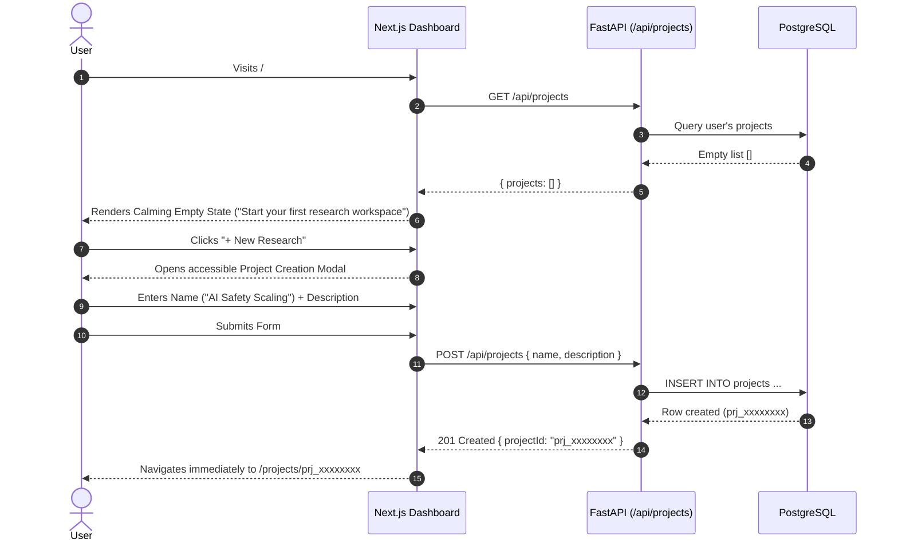
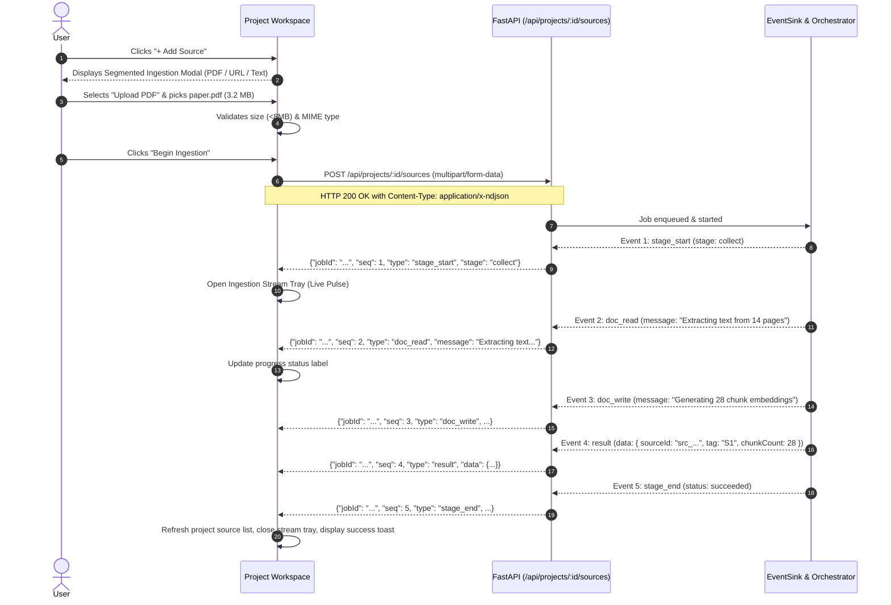

# Syntra — Frontend UX Blueprint & Implementation Specification
**Document ID:** docs/07-FRONTEND-UX-BLUEPRINT.md  
**Version:** 1.0  
**Status:** Approved for Implementation (Stage 3A Deliverable)  
**Target Application:** `apps/web` (Next.js 16, React 19, Tailwind CSS v4, TypeScript Strict)  
**Backend:** `apps/api` (FastAPI at `http://localhost:8000`)

---

## 1. Executive Summary & Product Objective

Syntra (Research Desk) is a multi-agent research workspace designed to help analysts, researchers, and professionals collect heterogeneous information (PDF documents, web URLs, pasted text), store it as structured evidence memory (PostgreSQL system of record + Qdrant vector index), synthesize claims, surface cross-source agreements or contradictions, and generate cited briefings.

Stage 3 transforms the initial Stage 0 connectivity test card into a calm, focused, utilitarian-minimalist research workspace. The experience prioritizes clarity, authentic server state, fast feedback, responsive navigation, and accessible interactions, strictly honoring the official Syntra Brand System and visual guidelines.

---

## 2. Current-State Audit & Reuse Analysis

### 2.1 Existing Codebase Inventory (`apps/web`)

| File | Current Role | Future Role in Stage 3 | Reuse Strategy |
|---|---|---|---|
| `package.json` | Dependencies: Next 16.4.3, React 19.3.0, Zod ^4.6.7, Tailwind v4. Dev: Vitest 5.0.5, ESLint 9. | Same stack; no new heavy dependencies needed. | Retain exactly as configured. All UI components will use standard React 19 + SVG primitives without bloated external UI packages. |
| `src/app/globals.css` | Only contains `@import "tailwindcss";`. | Global design system foundation. | Expand with CSS variables defining the Syntra Light and Dark theme tokens, font stacks, and subtle focus outlines. |
| `src/app/layout.tsx` | Minimal root HTML/body wrapper with metadata. | Application layout shell provider with theme and font configuration. | Update title, favicon, and brand metadata; set up HTML theme root. |
| `src/app/page.tsx` | Stage 0 connectivity card running `fetchHealth()`. | Main Research Dashboard (`/`). | Move the health check logic into a modular client; relocate diagnostic view to `/diagnostics`; make `/` the research project dashboard. |
| `src/lib/config.ts` | Resolves `NEXT_PUBLIC_API_BASE_URL` with Zod validation. | Environment configuration source of truth. | Retain and reuse directly across all API calls. |
| `src/lib/api/schemas.ts` | Zod schemas for `HealthResponse` and `ErrorEnvelope`. | API schema contract repository. | Expand with Zod schemas for `Project`, `Source`, `Job`, and `StreamEvent` matching `docs/05-API-SPEC.md`. |
| `tests/contracts.test.ts` | Validates `health.json` and `error.json` fixtures against Zod. | Contract test suite. | Retain and expand as new contract fixtures are added. |
| `tests/health.test.ts` | Unit tests for `fetchHealth()` error handling and abort signals. | API client test suite. | Retain; adapt import to point to the extracted API client helper. |

### 2.2 Backend Endpoints Ready for Stage 3 Integration

Syntra's backend is fully operational on `http://localhost:8000` with the following verified endpoints:

1. **Health & Readiness:**
   - `GET /api/health`: Liveness and service configuration booleans (`gemini`, `postgres`, `qdrant`).
   - `GET /api/health?db=1`: Readiness probe verifying live database and vector index connectivity.
2. **Project Management:**
   - `GET /api/projects`: Lists active projects owned by the user (sorted newest first) with `sourceCount` and `updatedAt`.
   - `POST /api/projects`: Creates a project with `{ name, description }` (returns 201 `{ projectId }`).
   - `GET /api/projects/:projectId`: Full project details: `project` header, `sources` list (with stages booleans and error status), `conflicts`, `briefs`, and running `activeJobs`.
   - `DELETE /api/projects/:projectId`: Cascades deletion across Qdrant vector index and PostgreSQL (returns 200 `{ deleted }`).
3. **Source Management:**
   - `POST /api/projects/:projectId/sources`: Ingestion endpoint accepting `multipart/form-data` (PDF with magic bytes check and 8MB cap) or `application/json` (URL or Pasted Text). Streams real-time NDJSON events.
   - `GET /api/projects/:projectId/sources/:sourceId`: Source details with `summary`, `claims`, and `verdicts`.
   - `DELETE /api/projects/:projectId/sources/:sourceId`: Deletes source, claims, and chunks. Returns 409 `JOB_ACTIVE` if a job is actively running for the source.
4. **Job Observability & Resumption:**
   - `GET /api/jobs/:jobId`: Returns operational status (`queued`, `running`, `succeeded`, `failed`) and result metadata.
   - `GET /api/jobs/:jobId/events?after=<seq>`: Streams persisted job events from sequence `seq` onwards, continuing with live tail until `stage_end`.

### 2.3 Strict Boundaries & Non-Assumptions
- **No Mock Agent Results:** Stage 4 (Analyst), Stage 5 (Critic), and Stage 6 (Writer / Ask) endpoints exist in various backend stages, but the Stage 3 UI must only surface them as clean "Upcoming Stage" indicators or previews based strictly on real backend data (`stages.analyzed`, `stages.critiqued`, `briefs`).
- **No Secret Leaks:** No API keys, JWT secrets, or internal database URLs in the client bundle.
- **Real Streaming:** Do not invent fake percentage progress bars. Ingestion progress will reflect actual server-emitted events (`stage_start`, `step`, `doc_read`, `doc_write`, `result`, `stage_end`, `error`).

---

## 3. Brand System & Visual Foundation

Based directly on `Syntra Brand System Styleboard.png` and `Syntra Brand Identity Guidelines.png`:

```
                       ✦
        ╭──────────────╮
       ╱   SYNTRA     ╱      "Read together. Think deeper."
      ╰──────────────╯
```

### 3.1 Color Palette & Theme Tokens

All colors are mapped to CSS custom variables in `globals.css` with dark mode support toggled via `.dark` or `data-theme="dark"`:

| Token Name | Light Theme Value | Dark Theme Value | Purpose & Usage |
|---|---|---|---|
| `--color-bg` | `#FAF9F7` (Paper) | `#0E0E10` (Obsidian Canvas) | Main application canvas background |
| `--color-surface` | `#F3F1ED` (Warm Surface) | `#16161A` (Dark Surface) | Sidebar, top header, input backgrounds |
| `--color-card` | `#FFFFFF` (Pure Paper) | `#1C1C21` (Card Elevation) | Content cards, dialogs, drawers |
| `--color-border` | `#E4E0DB` (Light Border) | `#2A2A31` (Dark Border) | Crisp 1px structural dividers and cards |
| `--color-text-primary` | `#1A1A1A` (Charcoal) | `#F4F4F5` (Zinc 100) | Primary headings, active labels, body text |
| `--color-text-secondary` | `#6B6861` (Warm Gray) | `#A1A1AA` (Zinc 400) | Secondary descriptions, timestamps, breadcrumbs |
| `--color-text-muted` | `#A7A399` (Muted) | `#6B6875` (Muted Zinc) | Placeholders, inactive icons, keyboard shortcuts |
| `--color-primary` | `#6B5BFF` (Violet) | `#7C6CFF` (Dark Violet) | Primary CTAs, active tab indicators, focus rings |
| `--color-primary-hover` | `#5A49E6` | `#6B5BFF` | Hover states on primary buttons |
| `--color-primary-soft` | `#EDE9FF` | `#2A2650` | Badge backgrounds, highlighted selection rows |
| `--color-success` | `#5C6F6A` (Sage) | `#5C6F6A` (Sage) | "Collected" status, verified citations, healthy checks |
| `--color-warning` | `#C97B6B` (Terracotta) | `#C97B6B` (Terracotta) | Nuances badge, recoverable stream warnings |
| `--color-error` | `#D9687A` (Blush) | `#D9687A` (Blush) | Contradictions badge, upload errors, connection loss |

### 3.2 Agent Identification System

In accordance with `docs/02-DESIGN-DOC.md` Section 10:
- **Collector:** Neutral Slate (`#6B6861` light / `#A1A1AA` dark)
- **Analyst:** Calming Blue (`#3B82F6` light / `#60A5FA` dark)
- **Critic:** Warm Amber (`#D97706` light / `#F59E0B` dark)
- **Writer:** Grounded Sage Green (`#059669` light / `#10B981` dark)

### 3.3 Typography

- **Primary Typeface:** Satoshi (geometric modern sans-serif with distinctive rounded terminals).  
  *Fallback Stack:* `font-family: 'Satoshi', -apple-system, BlinkMacSystemFont, "Segoe UI", Roboto, "Helvetica Neue", sans-serif;`
- **Monospace Typeface:** For source tags (`[S1]`, `clm_...`), IDs, and keystroke badges (`<kbd>⌘K</kbd>`):  
  *Stack:* `font-family: 'Geist Mono', 'SF Mono', 'JetBrains Mono', Menlo, Consolas, monospace;`
- **Typographic Rules:**
  - Tight tracking on headings (`tracking-tight` or `-0.02em`).
  - Generous line height on body text (`leading-relaxed` / `1.6`) for reading comfort.
  - No decorative uppercase headers except small, tracked metadata labels (`text-[11px] font-semibold uppercase tracking-wider`).

### 3.4 Official Logo Vector Specification

The Syntra mark consists of two geometric primitives:
1. The dynamic, sharp-cornered S ribbon.
2. The 4-point sparkle star positioned in the upper-right quadrant.
3. Wordmark: "Syntra" in clean geometric sans.

A bespoke, mathematically precise SVG component `SyntraLogo` will support:
- `variant="full"` (Mark + "Syntra" wordmark) for header and sidebar brand block.
- `variant="mark"` (Mark only) for compact mobile header and favicon.
- Monochrome rendering adapting cleanly to both light and dark themes.
- Clear-space padding adhering to star height $X$.

---

## 4. Information Architecture & Navigation

```
                                 ┌────────────────────────┐
                                 │      Syntra App        │
                                 └───────────┬────────────┘
                                             │
               ┌─────────────────────────────┼────────────────────────────┐
               │                             │                            │
     ┌─────────┴─────────┐         ┌─────────┴─────────┐        ┌─────────┴─────────┐
     │ Research Dashboard│         │ Project Workspace │        │ System Diagnostics│
     │       (`/`)       │         │ (`/projects/:id`) │        │  (`/diagnostics`) │
     └─────────┬─────────┘         └─────────┬─────────┘        └───────────────────┘
               │                             │
    ┌──────────┴──────────┐       ┌──────────┴──────────┐
    │ - New Project Modal │       │ - Sources Tab       │
    │ - Project List/Grid │       │ - Add Source Modal  │
    │ - Activity Summary  │       │ - Live Stream Tray  │
    │ - Empty State Hero  │       │ - Source Inspector  │
    └─────────────────────┘       │ - Delete Dialog     │
                                  │ - Insights (Preview)│
                                  │ - Ask (Preview)     │
                                  └─────────────────────┘
```

### 4.1 Route Map

1. **`/` (Research Dashboard):**
   - High-level overview of the user's research projects.
   - Project cards displaying: Title, Description, Source Count, Last Updated relative timestamp.
   - Primary Action: `+ New Research` (triggers creation modal).
   - Empty state for new users with guided explanation of Syntra's evidence loop.
2. **`/projects/[projectId]` (Project Workspace):**
   - Dedicated workspace for investigating a specific question.
   - Sub-views via clean segmented tabs:
     - `Sources`: Main Stage 3 workspace. Shows source cards, source status chips, "+ Add Source" action, real-time ingestion stream drawer, and source inspector drawer.
     - `Insights`: Stage 4/5 preview showing claims and detected conflicts if present.
     - `Ask`: Stage 6 preview showing briefing and synthesis.
3. **`/diagnostics` (System Diagnostics & Health):**
   - Retains and improves the Stage 0 health diagnostic capability.
   - Displays real-time API latency, service configuration (Gemini, PostgreSQL, Qdrant), and deep DB connectivity status (`GET /api/health?db=1`).

---

## 5. Core User Journeys & State Machines

### 5.1 Journey 1: First Visit → Create Research Project



### 5.2 Journey 2: Add Source with Live NDJSON Streaming



### 5.3 Journey 3: Stream Interruption & Resumption

If the network connection drops mid-stream:
1. `ReadableStream` triggers `error` or premature close.
2. The UI client marks connection status as `reconnecting`.
3. The client queries `GET /api/jobs/:jobId/events?after=<lastSeq>`:
   - Replays missed events sequentially without duplicating UI state.
   - Resumes live tail until `stage_end`.
4. If the job failed during the drop, the UI parses the terminal error event, presents the friendly message, and highlights the **Retry** action.

### 5.4 Journey 4: Source Inspection & Safe Deletion

1. Clicking a source card opens the **Source Detail Drawer** (`GET /api/projects/:id/sources/:sourceId`).
2. Displays metadata, extraction metrics, chunk count, and claims (if analyzed).
3. Clicking "Delete Source" triggers a high-contrast destructive confirmation dialog:
   - Warns: *"Deleting this source will remove its extracted text, vector chunks, and associated claims from evidence memory."*
4. Calls `DELETE /api/projects/:id/sources/:sourceId`.
5. If the server responds with 409 `JOB_ACTIVE`, the UI presents a polite message: *"Cannot delete while a research stage is running. Please wait for the job to complete."*
6. On 200 `{ deleted: true }`, updates local store, closes drawer, and shows confirmation toast.

---

## 6. Detailed Screen & Component Specifications

### 6.1 Application Shell (`AppShell`)
- **Structure:**
  - **Left Sidebar (Desktop, width 260px):**
    - Brand Header: `SyntraLogo` (full wordmark) with subtle hover indicator.
    - Quick Action: `+ New Research` primary button.
    - Navigation Links:
      - `Research` (Icon + label, links to `/`)
      - `Diagnostics` (Icon + label, links to `/diagnostics`)
    - Project Section:
      - Header: "PROJECTS" in uppercase muted 11px font with count badge.
      - Scrollable project list with active project indicator (violet left border + subtle background).
    - Footer: Theme Toggle (Light / Dark) + dev user profile indicator.
  - **Mobile Top Bar (< 768px):**
    - Compact header (height 56px).
    - Hamburger toggle button (`aria-label="Open Navigation"`).
    - Centered `SyntraLogo` (mark variant).
    - Slide-out mobile navigation drawer with backdrop overlay, focus lock, and escape key listener.
  - **Main Content Area:**
    - Maximum container width `max-w-6xl` centered with generous macro-whitespace (`px-6 py-8`).

### 6.2 Research Dashboard (`/`)
- **Header:**
  - Eyebrow: `RESEARCH WORKSPACE`
  - Title: `Explore. Compare. Understand.`
  - Description: `Collect diverse sources, synthesize evidence, and uncover agreements and contradictions with AI agents.`
- **Content:**
  - If projects exist: Bento-style project grid (1 col mobile, 2 col tablet, 3 col desktop) with:
    - Project Name (heading, bold, truncated at 2 lines)
    - Description (secondary text, truncated at 2 lines)
    - Metric Footer: Source count (`N sources`), updated relative time (`Updated 2h ago`).
  - If empty: Clean minimalist empty-state container with dashed border, warm background, descriptive copy, and a large primary `Create your first project` button.

### 6.3 Project Workspace (`/projects/[projectId]`)
- **Top Header Bar:**
  - Breadcrumb: `Research / [Project Name]`
  - Project Title & optional description with quick inline actions.
  - Action Group:
    - `+ Add Source` (Primary violet CTA)
    - `Delete Project` (Muted red outline button with confirmation dialog)
- **Segmented Workspace Tabs:**
  - `Sources`: List of evidence items with stage badges.
  - `Insights`: Source claims & cross-source contradictions (shows informative empty/preview state if unanalyzed).
  - `Ask`: Grounded briefing synthesis (shows informative empty/preview state).
- **Source List View:**
  - Table or crisp stacked cards with:
    - Tag badge: `[S1]`, `[S2]` (monospace, crisp pill)
    - Kind icon: PDF document, Web URL, Pasted text
    - Source Title & Origin (e.g. `arxiv-2304.pdf` or `https://nature.com/...`)
    - Extraction Metrics: `chunkCount` chunks, `claimCount` claims
    - Stage Indicator:
      - `Collected` (Sage check if true, Pulse if active)
      - `Analyzed` (Blue chip)
      - `Critiqued` (Amber chip)
    - Action Menu: View Details, Delete Source.
- **Empty Source State:**
  - "No sources collected yet."
  - "Add a PDF research paper, an online article URL, or pasted text to begin building the evidence memory."
  - Centered CTA: `+ Add First Source`.

### 6.4 Add Source Modal (`AddSourceModal`)
- Accessible dialog (`role="dialog"`, `aria-modal="true"`).
- Segmented tab control at top:
  1. **Upload PDF:**
     - Drag-and-drop zone with drag-over state.
     - Displays file name and size once chosen.
     - Enforces `MAX_UPLOAD_MB = 8`.
     - Optional title field.
  2. **Web Article (URL):**
     - URL input with format validation (`http://` or `https://`).
     - Clarification note: *"Public web pages only. Private or local addresses are blocked for security."*
     - Optional title field.
  3. **Pasted Text:**
     - Title input (required, 1-100 chars).
     - Textarea with live character counter.
     - Validation: `MIN_SOURCE_CHARS` (500) to `MAX_PASTE_CHARS` (400,000).
- Action buttons: "Cancel" (ghost) and "Add Source" (primary violet, disabled when form is invalid or submitting).

### 6.5 Live Ingestion Stream Tray (`StreamTray`)
- Floating or docked bottom tray that appears as soon as a source is submitted.
- Displays:
  - Header: Source title + active stage (`Collector: Ingestion in progress...`).
  - Event log: Scannable list of real server events with agent colors and timestamps.
  - Connection status badge (`Live` in green, `Reconnecting` in amber).
  - Dismiss / Minimize toggle so user can continue browsing while ingestion runs.

### 6.6 Source Inspector Drawer (`SourceDrawer`)
- Slide-over panel (width 480px on desktop, full width on mobile) anchored to the right.
- Displays:
  - Source Title and Tag (`[S1]`).
  - Origin link/file details.
  - Extracted Text Summary (when available).
  - Claim List with confidence tags.
  - Raw metadata (Chunk count, Creation date).
  - "Delete Source" destructive button at footer.

---

## 7. Reusable Design System Primitives

To maintain ultra-clean utilitarian minimalism without introducing bulky third-party libraries, we implement modular TypeScript components in `src/components/ui/`:

1. **`Button`**: Supports `variant="primary" | "secondary" | "ghost" | "danger"`, `size="sm" | "md" | "lg"`, loading spinner state, and keyboard focus rings.
2. **`Input` & `Textarea`**: High-contrast borders (`1px solid var(--color-border)`), warm background, accessible error text via `aria-describedby`.
3. **`Badge`**: Ultra-flat, pill-shaped (`rounded-full`), small typography (`text-xs tracking-wider uppercase font-semibold`), muted pastel accents.
4. **`StanceBadge`**: Dedicated badge for claim verdict stances:
   - `Supports`: Sage background, checkmark icon, "Supports" text.
   - `Contradicts`: Blush background, alert icon, "Contradicts" text.
   - `Nuances`: Terracotta background, wave/tilde icon, "Nuances" text.
   - `Unrelated`: Muted gray background, dash icon, "Unrelated" text.
5. **`Dialog` (Modal)**: Accessible modal with backdrop blur, focus trap, and Escape key dismissal.
6. **`Drawer` (Sheet)**: Slide-out drawer for mobile navigation and source inspection.
7. **`Skeleton`**: Subtle pulsing placeholders matching exact card shapes.
8. **`Toast`**: Non-intrusive floating notification for copy confirmation, upload success, and network warnings.

---

## 8. Accessibility & Usability (WCAG 2.1 AA)

- **Color Contrast:** All text tokens meet WCAG 2.1 AA ratios:
  - Primary text (`#1A1A1A` on `#FAF9F7` and `#F4F4F5` on `#0E0E10`) achieves > 11:1.
  - Secondary text achieves > 4.5:1.
  - Stance badges never rely on color alone; every badge includes an explicit icon and text label.
- **Keyboard Navigation:**
  - Tab order flows logically through sidebar navigation, action buttons, and content items.
  - Interactive controls have visible, high-contrast focus rings (`outline: 2px solid var(--color-primary)` with 2px offset).
  - Modals trap focus and return focus to the trigger button upon closure.
- **Screen Reader Support:**
  - Live streams use `aria-live="polite"` containers so screen readers announce stage transitions without overwhelming the user.
  - Form inputs are explicitly linked to labels (`htmlFor`) and helper/error text (`aria-describedby`).
- **Motion Sensitivity:**
  - Transitions adhere to `prefers-reduced-motion: reduce`, dropping smooth slide-ins in favor of instant visibility toggles.

---

## 9. Implementation Sequence Across Stages 3B, 3C, 3D

```
┌────────────────────────────────────────────────────────────────────────┐
│ Stage 3A: Audit & Blueprint (Complete)                                  │
│ - Comprehensive audit of apps/web and backend API                     │
│ - Architectural specification and brand token alignment                │
│ - Output: docs/07-FRONTEND-UX-BLUEPRINT.md                             │
└───────────────────────────────────┬────────────────────────────────────┘
                                    │
┌───────────────────────────────────▼────────────────────────────────────┐
│ Stage 3B: Design System & Workspace Shell                               │
│ - Set up CSS variables for light/dark themes in globals.css            │
│ - Implement official SyntraLogo component (mark + wordmark)            │
│ - Build responsive AppShell (sidebar, topbar, mobile drawer)           │
│ - Create API client module (src/lib/api/client.ts) for projects        │
│ - Implement Dashboard (/) with real project listing & creation modal   │
│ - Relocate Stage 0 health card to /diagnostics                         │
│ - Unit & contract tests for projects and navigation                    │
└───────────────────────────────────┬────────────────────────────────────┘
                                    │
┌───────────────────────────────────▼────────────────────────────────────┐
│ Stage 3C: Project Workspace & Source Management                        │
│ - Implement /projects/[projectId] workspace layout                     │
│ - Build AddSourceModal (tabbed PDF, URL, Pasted Text with validation)  │
│ - Implement NDJSON stream reader & StreamTray component                │
│ - Build Source List, Status Chips, and SourceDrawer inspector          │
│ - Implement Source deletion with 409 conflict handling                 │
│ - Integration tests for ingestion streaming & source operations        │
└───────────────────────────────────┬────────────────────────────────────┘
                                    │
┌───────────────────────────────────▼────────────────────────────────────┐
│ Stage 3D: Polish, Accessibility & Release Verification                 │
│ - Visual polish pass against styleboard & guidelines                   │
│ - Keyboard navigation & contrast audit                                 │
│ - Complete validation: npm run lint, typecheck, test, and build       │
│ - Live verification against local FastAPI backend                      │
└────────────────────────────────────────────────────────────────────────┘
```

---

## 10. Summary of Findings & Recommended First Step

### 10.1 Key Findings
1. **Strong Foundation:** The backend is fully capable of serving project creation, listing, deletion, multipart PDF streaming, JSON ingestion, and job event replay.
2. **Zero Architecture Drift:** The existing Next.js 16 + Tailwind v4 + Zod setup is lean and well-configured; no external component library or state management tool (Redux, Zustand) is required. Standard React hooks + clean native fetch streams provide optimal performance and full compliance.
3. **Brand Cohesion:** The provided brand assets offer an exceptionally crisp identity (Obsidian/Paper backgrounds, Satoshi typography, and the distinct Syntra star ribbon logo).

### 10.2 Recommended First Step for Stage 3B
Begin Stage 3B by:
1. Configuring the CSS custom properties in `apps/web/src/app/globals.css` to match the exact Syntra Light and Dark color palettes.
2. Building the SVG `SyntraLogo` component in `apps/web/src/components/brand/SyntraLogo.tsx`.
3. Creating `apps/web/src/lib/api/client.ts` to centralize all project and health API calls with Zod validation.
