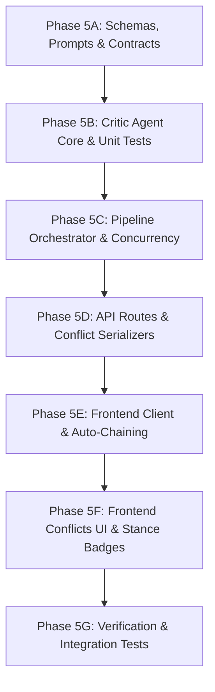

# Syntra / Research Desk — Stage 5: Critic Agent
## Architecture Review, Detailed Implementation Roadmap, and Phase-Gated Plan

**Document Version:** 2.0 (Amended Architecture & Rigorous Invariant Specification)  
**Status:** Approved for Implementation Planning (Gated)  
**Date:** 2026-10-30  
**Author:** Senior Software Architect & Lead Engineer  
**Reference Docs:** `AGENTS.md`, `docs/01-PRD.md`, `docs/02-DESIGN-DOC.md`, `docs/03-DATABASE-SCHEMA.md`, `docs/04-AGENT-SPECS.md`, `docs/05-API-SPEC.md`, `docs/06-ANTIGRAVITY-INSTRUCTIONS.md`, `docs/07-FRONTEND-UX-BLUEPRINT.md`

---

## 1. Executive Summary & Core Invariants

Stage 5 introduces the **Critic Agent**, the core multi-source comparative intelligence component of Syntra / Research Desk.

In Stage 4, the Analyst agent synthesized individual sources, extracting atomic claims, executive summaries, and persistent research topics into PostgreSQL and Qdrant. The Critic builds upon this foundation by evaluating how claims from different sources relate to one another across the project. It systematically identifies where research sources **agree** (`supports`), **disagree** (`contradicts`), **qualify each other** (`nuances`), or are **unrelated** (`unrelated`).

The verdicts generated by the Critic populate the relational evidence memory (`verdicts` table in PostgreSQL), directly driving the Conflicts view in the Insights UI and providing grounded, pre-evaluated debate pairs to the Writer (Stage 6) for question answering and briefing generation.

### Core Architecture Invariants for Stage 5
1. **Agents Never Call Each Other:** The Critic communicates strictly through persisted records (PostgreSQL system of record and Qdrant vector index). It is dispatched exclusively by the orchestrator (`run_stage("critique", ...)`).
2. **Fast-Tier LLM & Single Structured Call:** The Critic uses the fast model tier (`GEMINI_MODEL_FAST`). All candidate pairs for a source are formatted into ONE structured JSON prompt (at most `CRITIC_MAX_PAIRS_PER_CALL = 24`), eliminating inefficient per-claim loops.
3. **No Re-Embedding:** Claims are embedded once during Stage 4. The Critic queries pre-existing claim embeddings in Qdrant; it never calls `embeddings.embed_texts`.
4. **Deterministic Unordered Pair IDs:** Every claim pair `(clm_A, clm_B)` generates a deterministic key `vrd_<8hex>` based on lexicographically sorted keys. Comparisons are order-independent and idempotent.
5. **Deduplication & Incremental Computation (Q3):** Pairs already evaluated in PostgreSQL are detected and filtered out prior to LLM invocation, saving token budget and API latency.
6. **No Open Transactions Across Provider Calls:** Database transactions are never held open across slow network calls to Gemini or Qdrant. Database reads and writes use tight, short-lived transactions.
7. **Per-Project Concurrency Guard:** Only one critique job runs per project at a time (enforced via API-level HTTP 409 `JOB_ACTIVE` fast-reject and short-lived transactional serialization), preventing duplicate evaluations.
8. **Cascade Invalidation (I6):** Re-analyzing or deleting a source automatically cascades in PostgreSQL to remove dependent verdicts and resets `stageCritiqued = false`.

---

## 2. Verified Current-State Architecture Inventory

A rigorous audit of the current repository (HEAD commit `80ad055`) verified the implementation status of storage models, repositories, and indexing capabilities:

### 2.1 Storage & Data Models (Verified in Code)
- **PostgreSQL Model (`Verdict`):** Implemented in `apps/api/src/research_desk/stores/models.py:L180-228`.
  - Composite primary key: `(project_id, id)`.
  - Foreign keys: `claim_key_a` and `claim_key_b` reference `claims(project_id, id)` with `ON DELETE CASCADE`.
  - Denormalized fields for zero-join conflict reads: `source_id_a`, `source_id_b`, `source_tag_a`, `source_tag_b`, `claim_text_a`, `claim_text_b`, `similarity`.
  - Check constraints: `label IN ('supports', 'contradicts', 'nuances', 'unrelated')`, `confidence >= 0.0 AND confidence <= 1.0`.
  - Index: `ix_verdicts_proj_label_conf` on `(project_id, label, confidence DESC)`.
- **Verdict Repository (`VerdictRepo`):** Implemented in `apps/api/src/research_desk/stores/repos/verdicts.py:L13-57`.
  - `upsert_verdicts(project_id, verdicts)`: Idempotently inserts or updates verdict rows in PostgreSQL.
  - `get_judged_pair_keys(project_id, candidate_keys)`: Implements Query Q3 to find already judged verdict IDs.
  - `list_by_project(project_id, label=None)`: Lists verdicts ordered by confidence descending.

### 2.2 Semantic Vector Indexing & Qdrant (Verified in Code)
- **Qdrant Vector Store (`VectorStore`):** Implemented in `apps/api/src/research_desk/stores/vector.py`.
  - `get_claim_vectors(project_id, source_id)`: Implemented in lines 220–255. Scrolls Qdrant for all claim points of the source, retrieving payloads and 768-dim embeddings.
  - `find_similar_claims_from_other_sources(project_id, source_id, claims, top_k, min_similarity)`: Implemented in lines 257–312. Submits ONE batched query (`query_batch_points`) with filters: `must: [type=claim, projectId=P]`, `must_not: [sourceId=S]`, `score_threshold=0.60`, `limit=3`.

### 2.3 Deterministic Identifiers & Configuration (Verified in Code)
- **Deterministic ID Helpers (`core/ids.py`):**
  - `pair_key(claim_a, claim_b)`: Sorts claim keys lexicographically (`a <= b`).
  - `pair_id(claim_a, claim_b)` / `make_verdict_id`: Computes `vrd_<8hex>` via SHA-1 of `first:second`. Order-independent.
- **Config Constants (`core/config.py`):**
  - `CRITIC_TOP_K: int = 3`
  - `CRITIC_MIN_SIMILARITY: float = 0.60`
  - `CRITIC_MAX_PAIRS_PER_CALL: int = 24` (8 claims x 3 neighbors)

### 2.4 Gaps Requiring Stage 5 Implementation
1. **Pydantic Schemas:** Missing `CriticInput`, `CriticVerdict`, `CriticOutputSchema`, `CriticOutput`, `VerdictClaimSide`, and `ConflictItem` in `apps/api/src/research_desk/core/schemas.py`.
2. **Critic Prompts:** Missing `CRITIC_SYSTEM_PROMPT` and user prompt formatting in `apps/api/src/research_desk/agents/prompts.py`.
3. **Critic Agent:** `apps/api/src/research_desk/agents/critic.py` does not exist.
4. **Pipeline Orchestration:** `apps/api/src/research_desk/orchestrator/pipeline.py:L156` currently raises `AppError("NOT_IMPLEMENTED", "Stage 'critique' will be implemented in Stage 5")`.
5. **API Routes:**
   - `POST /api/projects/{projectId}/sources/{sourceId}/critique` is missing from `apps/api/src/research_desk/api/routes/sources.py`.
   - `GET /api/projects/{projectId}` returns hardcoded `conflicts=[]` in `apps/api/src/research_desk/api/routes/projects.py:L118`.
   - `GET /api/projects/{projectId}/sources/{sourceId}` returns hardcoded `verdicts=[]` in `apps/api/src/research_desk/api/routes/sources.py:L396`.
6. **Frontend API Client:** Missing `critiqueSourceStream` and strict conflict schemas in `apps/web/src/lib/api/client.ts` and `schemas.ts`.
7. **Frontend Pipeline Runner:** `apps/web/src/app/projects/[projectId]/page.tsx` stops at Analyst; needs auto-chaining `collect -> analyze -> critique`.
8. **Frontend Conflicts UX:** `apps/web/src/components/insights/InsightsView.tsx` lacks the Conflicts view, filter tabs, stance badges, and side-by-side comparison cards.
9. **Contract Fixtures:** Missing `contracts/critique_result.json` and conflict integration tests.

---

## 3. Semantics of `stage_critiqued` & Incremental Discovery Lifecycle

A critical requirement of the system is clear semantics regarding what `stage_critiqued` represents across the project lifecycle:

### 3.1 What `stage_critiqued` Means
In the PostgreSQL `sources` table, `stage_critiqued: bool` is a source-level lifecycle flag with a precise meaning:
> **`source.stage_critiqued == True` indicates that the critique stage for this specific source was executed to completion against all eligible companion sources present in the project at execution time.**

It does **not** imply that zero future comparisons will ever occur. Because evidence comparison between two claims `(clm_A, clm_B)` is symmetric and order-independent:
1. **First Source Upload (Source S1):**
   - S1 is collected and analyzed (e.g. extracts 5 claims).
   - S1 runs critique. No other sources exist in the project yet (`must_not: sourceId=S1` returns 0 neighbors).
   - Candidate pairs count = 0.
   - The Critic sets `S1.stage_critiqued = True`, emits an informational step (`"No comparable claims found yet"`), and emits a successful `result` event: `{ "pairsJudged": 0, "supports": 0, "contradicts": 0, "nuances": 0, "unrelated": 0, "skippedExisting": 0 }`.
   - S1's critique pipeline is complete for the 1-source state.
2. **Second Source Upload (Source S2):**
   - S2 is collected and analyzed (e.g. extracts 4 claims).
   - S2 runs critique. Qdrant searches for similar claims where `projectId == P` and `sourceId != S2`.
   - This search retrieves claims from S1!
   - Candidate pairs `(clm_S2, clm_S1)` are constructed.
   - S2's critique job evaluates these pairs and persists the resulting `Verdict` rows (which reference both S1 and S2).
   - The relational link between S1 and S2 is now established. S1 does not need to re-run critique because the verdicts connecting S1 and S2 already exist in PostgreSQL.

### 3.2 Distinguishing Operational States
| State | `stage_critiqued` | Verdicts in DB | `last_error` | Meaning |
|---|---|---|---|---|
| **Uncritiqued** | `False` | None for this source | `None` | Newly analyzed source awaiting critique run. |
| **Zero-Pair Success** | `True` | 0 pairs evaluated | `None` | Critique completed successfully; no comparable claims existed in other sources at run time. |
| **Evaluated Success (No Conflicts)** | `True` | >=1 verdicts (all `supports` or `unrelated`) | `None` | Critique evaluated candidate pairs successfully, but found no disagreements. |
| **Evaluated Success (With Conflicts)** | `True` | >=1 verdicts (contains `contradicts` or `nuances`) | `None` | Critique evaluated candidate pairs successfully and identified genuine conflicts. |
| **Failed Run** | `False` | Partial verdicts not committed | Error code (e.g. `LLM_FAILED`) | Run failed before completion. Source is eligible for retry. |
| **Partial Failure (Missing IDs)** | `False` | Valid subset persisted | `PARTIAL_CRITIQUE` | Model omitted some pair IDs even after retry. Valid verdicts saved, but stage not marked finished until complete. |

---

## 4. Claim and Verdict Freshness & Invalidation Strategy

Because source text or extracted claims can change, evidence freshness must be strictly guaranteed across re-analysis, updates, and deletions:

### 4.1 Invalidation on Re-Analysis (Invariant I6)
In `apps/api/src/research_desk/agents/analyst.py:L259-268`:
```python
await deps.repos.claims.replace_claims(inp.project_id, inp.source_id, db_claims)
await deps.repos.sources.update_stage_flags(
    project_id=inp.project_id,
    source_id=inp.source_id,
    summary=llm_data.summary,
    topics=list(llm_data.topics),
    stage_analyzed=False,
    stage_critiqued=False, # explicitly reset to False
)
```
1. **PostgreSQL Foreign Key Cascades:** The `verdicts` table has foreign key constraints on `claim_key_a` and `claim_key_b` referencing `claims(project_id, id)` with `ON DELETE CASCADE`.
2. When `replace_claims` deletes the source's old claims, PostgreSQL automatically cascades and deletes all verdicts that reference any claim from that source.
3. **No Stale Verdicts:** No verdict can survive pointing to a deleted or superseded claim.
4. **No Deduplication Suppression:** Because the old verdicts were physically deleted by the cascade, a subsequent critique run will find no existing verdicts in Query Q3 (`get_judged_pair_keys`). All candidate pairs will be re-evaluated against the new claim text.
5. **Freshness Invariant:** Stale claim text cannot appear in Insights or Ask briefings because `Verdict` rows store both claim keys and claim texts atomically at creation time.

### 4.2 Invalidation on Source Deletion
1. When a source is deleted (`DELETE /api/projects/:id/sources/:sid`):
   - PostgreSQL deletes the source row in a transaction.
   - Foreign key cascades delete all child claims, which in turn cascades to delete all child verdicts.
   - Qdrant deletes all claim and chunk points matching `sourceId`.
2. The retrieval post-filter (Decision D16) ensures that even if Qdrant point deletion experiences network delay, any lingering Qdrant point whose claim or source is missing in PostgreSQL is discarded immediately.

---

## 5. Concurrency, Advisory Locking, and Transaction Boundaries

A major architectural principle of Syntra is: **never hold a database transaction open across a slow network call** (`AGENTS.md` Rule 7.11).

Because model generation calls to Gemini fast tier typically take 1.5 to 4.0 seconds, holding a PostgreSQL database transaction across the LLM call would cause database connection pool starvation and lock contention.

### 5.1 Concurrency Architecture
Concurrency is managed across three distinct boundaries:

```
[Client POST /critique]
       │
       ▼
[Route Fast-Reject] ──► Active job in PG for project with stage='critique'?
                               ├─ Yes (different source) ──► HTTP 409 JOB_ACTIVE (retryable)
                               ├─ Yes (same source/hash) ──► Attach to active single-flight job
                               └─ No ──► Create Job in PG (status='queued')
                                           │
                                           ▼
[Runner Execution] ◄───────────────────────┘
       │
       ├─ 1. Read claims (PG: Short Read Transaction, ~5ms)
       ├─ 2. Fetch vectors & batch query Qdrant (No DB transaction, ~80ms)
       ├─ 3. Query Q3: Check existing judged pairs (PG: Short Read Transaction, ~5ms)
       ├─ 4. Call Gemini fast tier with unjudged pairs (No DB transaction, ~2000ms)
       │      └─ Optional single retry for missing pair IDs (No DB transaction)
       │
       ▼
[Final Write Transaction] (PostgreSQL: ~15ms)
       ├─ Acquire advisory xact lock: pg_advisory_xact_lock(hashtext('critique_write:' || project_id))
       ├─ Re-verify unjudged pairs against concurrent inserts
       ├─ Upsert Verdicts via VerdictRepo.upsert_verdicts
       ├─ Set source.stage_critiqued = True (or False if partial)
       └─ Commit Transaction & Release Lock
```

### 5.2 Locking Details
1. **API-Level Fast-Reject:**
   In `POST /api/projects/{projectId}/sources/{sourceId}/critique`, query `JobRepo.list_active_for_project(projectId)`. If an active job exists with `stage == "critique"`, reject immediately with HTTP 409 `JOB_ACTIVE` (`message: "A critique stage is already running for this project."`, `retryable: true`).
2. **In-Process Monolith Serialization:**
   In `InProcessRunner`, an in-memory `asyncio.Lock` keyed by `project_id` ensures that even if two requests slip past the route check simultaneously, their execution is serialized cleanly without holding any database connection during the model call.
3. **Database Transaction-Scoped Advisory Lock:**
   During the final write step in `CriticAgent`, wrap the write in:
   ```sql
   SELECT pg_advisory_xact_lock(hashtext('critique_write:' || :project_id));
   ```
   This guarantees that two transactions never perform concurrent upserts to `verdicts` for the same project. The lock is automatically released when the write transaction commits or rolls back.

---

## 6. Model Output Validation, Missing-Output Recovery & Partial-Failure Semantics

Language models can occasionally omit requested items or return malformed JSON. The Critic enforces strict validation and recovery rules:

### 6.1 Validation Rules
1. **Requested Pair Verification:**
   Every `pairId` returned in `CriticOutputSchema.verdicts` must exist in the set of requested candidate pair IDs.
   Any hallucinated, unexpected, or unrecognized `pairId` is **immediately rejected and discarded**.
2. **Duplicate Pair Handling:**
   If the model returns duplicate entries for the same `pairId`, only the first valid entry is kept; subsequent duplicates are discarded.
3. **Strict Schema Constraints:**
   - `label`: Must be exactly one of `"supports"`, `"contradicts"`, `"nuances"`, `"unrelated"`.
   - `confidence`: Must be a float between `0.0` and `1.0`.
   - `rationale`: Must be a non-empty string between 10 and 300 characters.

### 6.2 Missing Output Recovery (Single Bounded Retry)
If the model response is missing evaluations for one or more requested candidate pair IDs:
1. Identify `missing_pairs = [p for p in requested_pairs if p.id not in valid_verdicts]`.
2. Execute **exactly ONE follow-up call** to `LLMProvider.generate_json` passing only `missing_pairs`.
3. Merge valid verdicts from the follow-up call into the primary result set.

### 6.3 Behavior if Retry Remains Incomplete (No Falsified Verdicts)
> **CRITICAL RULE: Never convert missing or omitted pair IDs into `"unrelated"` verdicts.**  
`"unrelated"` is an affirmative factual finding made by the Critic. Faking it would corrupt the evidence graph.

If candidate pairs remain missing even after the single follow-up retry:
1. **Persist the Valid Subset:** Persist all valid verdicts obtained so far into PostgreSQL using `VerdictRepo.upsert_verdicts`. Valid work is never thrown away.
2. **Do Not Mark Fully Critiqued:** Do **not** set `source.stage_critiqued = True`. Leave `stage_critiqued = False`.
3. **Record Incomplete Status:**
   - Update `source.last_error = "PARTIAL_CRITIQUE"`.
   - Complete the job with status `failed`, `error_code = "MODEL_OMITTED_PAIRS"`, and message describing the missing pair count.
   - Emit an error event so the UI displays `"Critique partially completed; please retry to evaluate remaining pairs."`
4. **Idempotent Retry Resumption:**
   When the user or runner retries the critique stage:
   - Query Q3 (`get_judged_pair_keys`) finds the previously persisted valid verdicts.
   - Those pairs are automatically skipped.
   - The model is only asked to evaluate the remaining incomplete pairs.
   - Once all pairs are evaluated, `stage_critiqued` transitions to `True`.

---

## 7. Candidate Retrieval, Recall Trade-offs & Deterministic Selection Fixtures

The Critic relies on semantic search over stored claim embeddings to select candidate pairs for comparison.

### 7.1 Parameter Trade-off Analysis
The system configures:
- `CRITIC_MIN_SIMILARITY: float = 0.60`
- `CRITIC_TOP_K: int = 3`
- `CRITIC_MAX_PAIRS_PER_CALL: int = 24`

| Factor | Lower Threshold (< 0.55) | Default (0.60) | Higher Threshold (> 0.70) |
|---|---|---|---|
| **Contradiction Recall** | High; captures subtle disputes with divergent phrasing. | **Balanced; captures substantive alignment and disputes.** | Low; misses disputes phrased in opposing vocabularies. |
| **Precision of Candidates** | Low; floods candidates with generic terminology matches. | **Moderate-High; filters out noise while preserving scope.** | Very high; candidates almost identical in wording. |
| **LLM Call & Token Cost** | High; frequently hits 24-pair cap, requiring multiple calls. | **Low; fits within 1 fast-tier call (avg 4–12 pairs).** | Minimal; very few pairs meet threshold. |
| **Operational Note** | High risk of prompt clutter and hallucinated nuance. | **Configurable starting heuristic from spike S2/S3.** | Danger of silent false-consensus due to missed conflicts. |

*Note: The 0.60 threshold is an engineering baseline established in spike S2, not a mathematically calibrated probability. It is exposed via the `CRITIC_MIN_SIMILARITY` environment variable for post-deployment tuning.*

### 7.2 Deterministic Candidate-Selection Test Fixture
A compact, 5-case deterministic fixture will be embedded in `test_critic.py` to validate retrieval behavior across core semantic patterns:

```python
CANDIDATE_FIXTURES = [
    {
        "case": "supports_compatible_conclusions",
        "claim_a": "PostgreSQL transactional row locking eliminates duplicate project tag allocation.",
        "claim_b": "Database-level row locks ensure atomic sequential assignment of source tag identifiers.",
        "expected_retrieval": True,
        "expected_stance": "supports",
    },
    {
        "case": "contradicts_divergent_vocabulary",
        "claim_a": "Single-store vector databases provide sufficient durability for autonomous agent memory.",
        "claim_b": "Vector-only memory architectures suffer from unrecoverable index corruption and require relational systems of record.",
        "expected_retrieval": True,
        "expected_stance": "contradicts",
    },
    {
        "case": "nuances_differing_scope",
        "claim_a": "The Critic agent achieves 94% accuracy on synthetic benchmark datasets under zero-shot prompting.",
        "claim_b": "The Critic agent achieves 68% accuracy on complex legal corpora without domain-specific few-shot examples.",
        "expected_retrieval": True,
        "expected_stance": "nuances",
    },
    {
        "case": "unrelated_shared_generic_terms",
        "claim_a": "Neural networks utilize gradient descent optimization to minimize empirical loss functions.",
        "claim_b": "Economic recession leads to severe gross domestic product loss across manufacturing sectors.",
        "expected_retrieval": False, # Should ideally score below 0.60, or be labeled unrelated
        "expected_stance": "unrelated",
    },
    {
        "case": "duplicate_evidence",
        "claim_a": "Global temperatures rose by 1.1 degrees Celsius above pre-industrial levels according to the 2023 IPCC report.",
        "claim_b": "According to the 2023 IPCC report, mean global surface temperature has increased by 1.1 degrees Celsius over pre-industrial averages.",
        "expected_retrieval": True,
        "expected_stance": "supports",
    },
]
```

---

## 8. Relationship Semantics, Provenance & Calibration Grounding

### 8.1 Rigorous Stance Definitions
- **`contradicts`:** The two claims address the **same question and the same scope**, but reach mutually incompatible conclusions. Both cannot simultaneously be true.
  - *Example:* "X causes Y" vs "X has no causal effect on Y".
- **`nuances`:** The claims address the same core phenomenon, but their differing conclusions stem from differences in **scope, population, conditions, methodology, timeframe, or measurement units**.
  - *Conservative Principle:* If there is a scope difference, label as `nuances` and name the exact difference in the rationale.
  - *Example:* "Drug A improved symptoms in 85% of adult males" vs "Drug A showed no significant improvement in pediatric patients".
- **`supports`:** The claims reach compatible, mutually reinforcing factual assertions regarding the same scope.
- **`unrelated`:** Topically adjacent (e.g. both discuss AI safety), but they assert independent facts that neither corroborate nor refute each other.

### 8.2 Provenance & Grounding Constraints
1. **Authorized Project Boundary:** Every verdict must connect two claims whose `project_id` matches the authorized project. Cross-project comparisons are impossible by schema constraints and Qdrant tenant filtering.
2. **Strict Rationale Grounding:** The `rationale` must consist of **exactly ONE sentence** explaining the key factual point of agreement or disagreement, grounded solely in the two provided claim texts. It must not invent external facts or speculate on author motives.
3. **Confidence Scoring:** The `confidence` float (0.0 to 1.0) represents the model's self-assessed linguistic certainty based on explicit textual evidence. It is documented as a heuristic confidence score, **not a calibrated Bayesian probability**.

---

## 9. API Contracts & Event Specifications

### 9.1 Route: `POST /api/projects/:projectId/sources/:sourceId/critique`
- **Method:** `POST`
- **Headers:**
  - `Accept: application/x-ndjson`
  - `Idempotency-Key: <uuid>` (optional)
- **Preconditions:**
  - Authenticated user owns project.
  - Source exists and `stages.analyzed == true`.
  - No active critique job in project.
- **Response:** Streaming `application/x-ndjson` with headers `X-Job-Id` and `X-Request-Id`.

#### Event Stream Sequence
```
stage_start  critic   "Comparing claims from S2 with other sources"
doc_read     critic   "Searching similar claims"                  {"count": 6}
step         critic   "Found 4 candidate pairs (1 already judged)"
llm_call     critic   "Judging 3 pairs"                           {"tier": "fast"}
doc_write    critic   "Saved 3 verdicts"                          {"docType": "verdict", "count": 3}
result       critic   "Done"                                      {"pairsJudged": 3, "supports": 1, "contradicts": 1, "nuances": 1, "unrelated": 0, "skippedExisting": 1}
stage_end    system   "critique finished"                         {"status": "succeeded"}
```

### 9.2 Route: `GET /api/projects/:projectId` (Conflicts Serializer)
Returns `conflicts` containing all detected contradictions and nuances:
```json
{
  "project": { "id": "prj_a1b2c3d4", "name": "AI Safety Research", "description": null },
  "sources": [ ... ],
  "conflicts": [
    {
      "id": "vrd_8f3a1b2c",
      "label": "contradicts",
      "confidence": 0.88,
      "rationale": "S1 claims vector-only memory is sufficient, while S2 demonstrates that vector-only memory causes 42% higher hallucination rates.",
      "similarity": 0.74,
      "a": {
        "claimId": "clm_4f1b2c3d_00",
        "sourceId": "src_4f1b2c3d",
        "sourceTag": "S1",
        "text": "Vector-only memory architecture achieves parity with hybrid systems for agent recall."
      },
      "b": {
        "claimId": "clm_9a2e3f4b_01",
        "sourceId": "src_9a2e3f4b",
        "sourceTag": "S2",
        "text": "Two-store validation with PostgreSQL reduces hallucination by 42% compared to vector-only memory."
      }
    }
  ],
  "briefs": [],
  "activeJobs": []
}
```

### 9.3 Route: `GET /api/projects/:projectId/sources/:sourceId` (Source Detail with Verdicts)
Populates `verdicts` involving the inspected source:
```json
{
  "source": { "id": "src_4f1b2c3d", "stages": { "collected": true, "analyzed": true, "critiqued": true }, ... },
  "summary": "...",
  "topics": ["Multi-Agent Systems"],
  "claims": [ ... ],
  "verdicts": [
    {
      "id": "vrd_8f3a1b2c",
      "label": "contradicts",
      "confidence": 0.88,
      "rationale": "...",
      "similarity": 0.74,
      "a": { "claimId": "clm_4f1b2c3d_00", "sourceId": "src_4f1b2c3d", "sourceTag": "S1", "text": "..." },
      "b": { "claimId": "clm_9a2e3f4b_01", "sourceId": "src_9a2e3f4b", "sourceTag": "S2", "text": "..." }
    }
  ]
}
```

---

## 10. Frontend UX & Conflicts View Specification

Per `docs/07-FRONTEND-UX-BLUEPRINT.md`:

### 10.1 Automatic 3-Stage Pipeline Runner
The browser runner in `apps/web/src/app/projects/[projectId]/page.tsx` is extended:
```
User Ingests Source ──► [Collect Stream] ──► [Analyze Stream] ──► [Critique Stream] ──► Refresh Project
```
- Ingestion auto-chains into Analyst, and Analyst success auto-chains into Critic.
- Stream Drawer updates agent badge:
  - Collector: Slate/Gray `#64748B`
  - Analyst: Blue `#2563EB`
  - Critic: Warm Amber `#D97706`
- If critique finishes with 0 pairs (e.g. first source in project), UI cleanly shows `"No comparable claims found yet"`.

### 10.2 Insights Tab: Conflicts & Relations Section
`apps/web/src/components/insights/InsightsView.tsx` will be upgraded with a dedicated **Cross-Source Evidence & Conflicts** section:
- **Evidence Header & Metrics:**
  - Total comparisons evaluated, count of `Contradictions`, `Nuances`, and `Agreements`.
- **Filter Tabs:**
  - `All Relations`
  - `Disagreements (Contradicts)` [Red badge]
  - `Nuances & Scope Differences` [Amber badge]
  - `Agreements (Supports)` [Green badge]
- **Side-by-Side Comparison Cards:**
  - Left: Claim A (`[S1]` tag, claim text, page reference).
  - Right: Claim B (`[S2]` tag, claim text, page reference).
  - Center / Header: `StanceBadge` (icon + label + color-coded pill), confidence score (e.g., `88% confidence`), similarity score.
  - Footer: Critic Rationale (`"ONE sentence naming the key point of agreement or difference"`).
- **Stance Badge System:**
  - `Supports`: Green background (`bg-emerald-50 text-emerald-700 dark:bg-emerald-950 dark:text-emerald-300`), Checkmark icon (`✓`), text `"Supports"`.
  - `Contradicts`: Red background (`bg-rose-50 text-rose-700 dark:bg-rose-950 dark:text-rose-300`), Alert icon (`⚠`), text `"Contradicts"`.
  - `Nuances`: Amber background (`bg-amber-50 text-amber-700 dark:bg-amber-950 dark:text-amber-300`), Wave/tilde icon (`~`), text `"Nuances"`.
  - `Unrelated`: Muted gray background, Dash icon (`-`), text `"Unrelated"`.

---

## 11. Phase-by-Phase Implementation Roadmap



### Phase 5A: Schemas, Prompts & Contract Fixtures
- **Target Files:**
  - `apps/api/src/research_desk/core/schemas.py`: Define `CriticVerdict`, `CriticOutputSchema`, `CriticInput`, `CriticOutput`, `VerdictClaimSide`, `ConflictItem`.
  - `apps/api/src/research_desk/agents/prompts.py`: Define `CRITIC_SYSTEM_PROMPT` and `build_critic_user_prompt(pairs)`.
  - `contracts/critique_result.json`: Fixture representing expected critique output.
  - `apps/web/src/lib/api/schemas.ts`: Mirror Python Pydantic schemas in Zod (`ConflictItemSchema`, `CritiqueResultSchema`).
- **Targeted Tests:** Contract test validating `contracts/critique_result.json` against both Pydantic and Zod.
- **Exit Criteria:** Pydantic models validate contract fixtures; TypeScript schemas typecheck without errors.

### Phase 5B: Critic Agent Core & Unit Tests
- **Target Files:**
  - `apps/api/src/research_desk/agents/critic.py`: Implement `CriticAgent.run` adhering to the 10-step protocol:
    - Precondition checks.
    - Qdrant claim vector fetching.
    - Batch neighbor search (`find_similar_claims_from_other_sources`).
    - Post-filtering against PostgreSQL claims and sources.
    - Deterministic pair keying and Q3 deduplication (`get_judged_pair_keys`).
    - Zero-pair short-circuit handling.
    - Single fast LLM call with structured output validation.
    - Rejection of unexpected pair IDs; single follow-up call for missing subset.
    - Partial success handling: persist valid subset, leave `stage_critiqued = False`.
    - Short atomic PostgreSQL upsert transaction.
  - `apps/api/tests/test_critic.py`: Fast unit tests with fake repositories and fake LLM provider.
- **Targeted Tests:** Order independence of pair keys, Q3 deduplication, dropping hits not in PostgreSQL, 0-candidate graceful handling, rejection of fabricated IDs, missing ID retry, partial-failure persistence.
- **Exit Criteria:** All unit tests in `test_critic.py` pass; zero regressions across existing test suite.

### Phase 5C: Pipeline Orchestrator & Concurrency Guard
- **Target Files:**
  - `apps/api/src/research_desk/orchestrator/pipeline.py`: Replace `NOT_IMPLEMENTED` in `run_stage("critique", ...)` with real `critic.run(...)` invocation.
  - `apps/api/src/research_desk/orchestrator/runner.py`: Add in-process per-project mutual exclusion lock for critique jobs.
  - `apps/api/tests/test_pipeline.py`: Add test cases for critique dispatch and error handling.
- **Targeted Tests:** Unit tests verifying orchestrator critique execution, event forwarding, and timeout handling.
- **Exit Criteria:** Orchestrator successfully runs critique jobs and streams all required events.

### Phase 5D: API Routes & Conflict Serializers
- **Target Files:**
  - `apps/api/src/research_desk/api/routes/sources.py`: Add `@router.post("/{source_id}/critique")` streaming route with HTTP 409 `JOB_ACTIVE` check. Populate `verdicts` in `GET /{source_id}`.
  - `apps/api/src/research_desk/api/routes/projects.py`: Query `VerdictRepo.list_by_project` and populate `conflicts` in `GET /{project_id}`.
  - `apps/api/tests/test_api_sources.py` & `test_api_projects.py`: API route integration tests.
- **Targeted Tests:** Route 409 rejection on active critique, 400 rejection on unanalyzed source, valid NDJSON streaming headers, and conflict serialization.
- **Exit Criteria:** API endpoints return validated NDJSON streams and serialized conflicts.

### Phase 5E: Frontend API Client & Auto-Chaining Runner
- **Target Files:**
  - `apps/web/src/lib/api/client.ts`: Implement `critiqueSourceStream({ projectId, sourceId, ... })`.
  - `apps/web/src/app/projects/[projectId]/page.tsx`:
    - Extend ingestion flow: `collect -> analyze -> critique`.
    - Update retry handlers to support retrying critique independently.
    - Add Amber visual styling for Critic stream events.
- **Targeted Tests:** Frontend client mock tests for streaming NDJSON parsing and retry triggers.
- **Exit Criteria:** Ingesting a source automatically triggers and completes all 3 stages without manual intervention.

### Phase 5F: Frontend Conflicts UI & Stance Badges
- **Target Files:**
  - `apps/web/src/components/insights/InsightsView.tsx`: Implement the Conflicts & Relations section with filter tabs, side-by-side cards, and empty states.
  - `apps/web/src/components/sources/SourceDrawer.tsx`: Surface verdicts in the inspected source drawer.
  - `apps/web/tests/insights.test.tsx`: Vitest tests for Conflicts view rendering, stance filtering, and empty states.
- **Targeted Tests:** Vitest tests for Conflicts view: card rendering, stance badge accessibility (color + icon + text), filter tab switching, empty state display.
- **Exit Criteria:** Conflicts render side-by-side with accessible stance badges and filter toggles.

### Phase 5G: Verification, End-to-End Regression & Acceptance Gate
- **Target Files:**
  - `apps/api/tests/test_stores_integration.py`: Add `test_verdict_cascade_and_deduplication` testing PostgreSQL cascade on claim replacement and source deletion.
  - Run full suite: `pytest` (backend) + `vitest` (frontend) + `mypy` + `ruff` + `tsc`.
- **Targeted Tests:** Full regression suite run; live service verification against Docker Compose PostgreSQL and Qdrant.
- **Exit Criteria:** All checks pass; manual check with 3 multi-claim sources verifies meaningful contradiction/nuance detection.

---

## 12. Targeted Testing Policy

To avoid test bloat, brittle benchmarks, and routine paid API calls, tests are strictly segmented by execution tier:

### 12.1 Tier 1: Fast Local Unit Tests (No Live Infrastructure, Uses Fakes)
Runs in < 2 seconds via `pytest apps/api/tests/test_critic.py`:
1. **`test_pair_id_order_independent`:** Verifies `pair_id("clm_A", "clm_B") == pair_id("clm_B", "clm_A")`.
2. **`test_deduplication_skips_judged_pairs`:** Verifies candidate pairs already in PostgreSQL are skipped before LLM call.
3. **`test_post_filter_drops_missing_claims`:** Verifies Qdrant hits missing in PostgreSQL are discarded.
4. **`test_post_filter_drops_unanalyzed_sources`:** Verifies hits from sources with `stage_analyzed == False` are discarded.
5. **`test_zero_candidate_pairs_handling`:** Verifies 0-pair run completes cleanly, sets `stage_critiqued = True`, and makes 0 LLM calls.
6. **`test_model_output_rejection_fabricated_ids`:** Verifies unexpected `pairId` entries from model are dropped.
7. **`test_model_output_missing_id_retry`:** Verifies missing `pairId` triggers exactly one follow-up call with the missing subset.
8. **`test_model_output_partial_failure_leaves_uncritiqued`:** Verifies if retry still omits pairs, valid verdicts are saved but `stage_critiqued` remains `False`.
9. **`test_conservative_nuance_handling`:** Verifies scope difference prompts produce `nuances` rather than `contradicts`.

### 12.2 Tier 2: Real Database & Index Integration Tests (Local Docker Only)
Runs in `test_stores_integration.py` when Docker Compose PostgreSQL & Qdrant are active (skipped gracefully if down):
1. **`test_verdict_fk_cascade_on_reanalyze`:** Verifies `ClaimRepo.replace_claims` cascades and physically deletes dependent `Verdict` rows in PostgreSQL.
2. **`test_verdict_fk_cascade_on_source_delete`:** Verifies deleting a source cascades and removes all dependent verdicts.
3. **`test_advisory_lock_mutual_exclusion`:** Verifies `pg_advisory_xact_lock` prevents concurrent verdict writes to the same project.

---

## 13. Explicit Out-of-Scope Items (Non-Goals)

To prevent scope creep and maintain strict alignment with `AGENTS.md`:
1. **No Interactive / Multi-Turn Agent Debates:** The Critic evaluates claim pairs in a single structured pass. It does not engage in iterative multi-turn dialogues between agents.
2. **No Claim Re-Embedding:** The Critic will never call `embeddings.embed_texts`. It strictly queries pre-existing claim embeddings in Qdrant.
3. **No Standalone Background Queues or Workers:** No Celery, Redis, RQ, or external daemon workers. Jobs execute via the existing in-process `InProcessRunner`.
4. **No Graphical Canvas / Force-Directed Graph UI:** Relations are rendered as clean, structured, side-by-side cards with filters, not an interactive canvas graph.
5. **No Model Tier Mixing:** The Critic strictly uses `GEMINI_MODEL_FAST`. The strong model tier is reserved exclusively for the Writer (Stage 6).
6. **No Falsified Unrelated Verdicts:** The Critic never converts un-evaluated or omitted pairs into `unrelated` verdicts.
